# Architecture

This document describes the internal structure, dependency rules, and runtime flows of `platform-reactcommon`.

`platform-reactcommon` is a **private pnpm monorepo** of three packages, released together under one version (changesets `fixed`, `1.0.0-alpha.N` until the first environment):

- **`@bcbp-solutions-fzc-llc/frontend-sdk`**: the shared TypeScript SDK every React micro-frontend (shell and remotes) uses. Its 17 subpaths are `/core` … `/react`, `/testing`, and there is no root barrel. It is **contract-compatible with platform-gincommon and platform-fastapicommon**:
  - the same identity vocabulary and metric registry (Enterprise Platform Observability Standard);
  - RFC 9457 Problem Details;
  - the header names, the redaction rules, and the Go trace sampler.

  It is the browser's side of IAM: Keycloak sign-in (Authorization Code + PKCE, tokens in memory only), workspace (realm) choice, session restore, idle timeout, step-up.
- **`@bcbp-solutions-fzc-llc/webpack-preset`**: the Module Federation shared map (strict singletons, the SDK provided only by the shell), chunk integrity and CSP-safe output (Trusted Types, no `eval`, hidden source maps), for webpack 5 and, through its `/rspack` and `/rsbuild` entry points, Rspack and Rsbuild (the same v1 federation protocol, so the bundlers can be mixed).
- **`@bcbp-solutions-fzc-llc/eslint-plugin`**: seven rules that enforce in consumer code what the design requires:
  - SDK subpaths only;
  - no identity headers;
  - storage and HTML only through the SDK;
  - no runtime CSS-in-JS;
  - route templates for API paths.

`examples/` holds a reference shell, the tenders remote and the CloudFront/CSP snippets. None of it is deployed from here. The decisions behind all of this are in [`docs/design/frontend-sdk-design.md`](docs/design/frontend-sdk-design.md) (the decision record). This document and the [LLD](docs/lld/platform-reactcommon-lld.md) describe the implementation as built.

**Does not own:**
- **Authentication and authorization decisions:** the API gateway (Envoy + IAM AuthZ Enrichment) validates the token and injects identity; the browser never sends identity headers, and `/authz` is a UI hint only.
- **Keycloak realms and clients:** IAM's realm provisioner.
- **IAM APIs:** PUB-1 tenant resolve and P-35 session context. The shell implements them as ports over the SDK's `ApiClient`.
- **The OTel Collector, Loki, Tempo, Mimir and Grafana.**
- **Ratifying the proposed `platform_web_*` metrics:** observability governance (design doc §D5).
- **CloudFront, S3 and the deploy pipeline:** `examples/cloudfront` documents what they must do.
- **Any UI component library.**

---

## Layer model

Six layers, enforced twice: `eslint-plugin-boundaries` (lint) and dependency-cruiser (CI), both generated from `packages/frontend-sdk/subpaths.json`. A subpath imports another only through its `index.ts`. **Only `/react` and `/testing` import React; only `/tracing`, `/logging` and `/metrics` import OpenTelemetry.** Subpaths never read each other's module state: they share state through the `PlatformRuntime` in `src/internal`, which may itself import only `/core`.

> Source: [`docs/architecture/mermaid/layer-model.mmd`](docs/architecture/mermaid/layer-model.mmd)

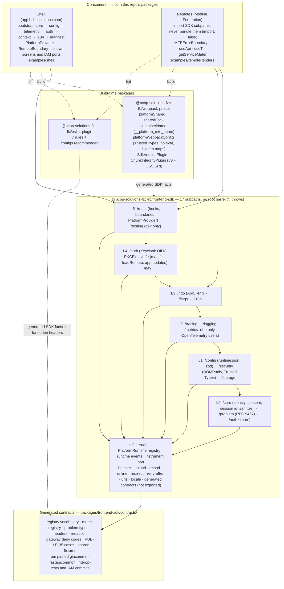

| Layer | Subpaths | Responsibility |
|---|---|---|
| 0 | `/core`, `/problem`, `/authz` | Page identity (registry vocabulary), consent, RUM session id, sanitizing; RFC 9457 model and parsing; the pure UI authorizer |
| 1 | `/config`, `/security`, `/storage` | `runtime.json` (zod, strict, frozen); DOMPurify + the `platform-sdk` Trusted Types policy; per-workspace storage that refuses token-like keys |
| 2 | `/tracing`, `/logging`, `/metrics` | OTLP/HTTP export to `/otel`, consent-gated, bounded queues; registry-checked Tier 2/3 meters |
| 3 | `/http`, `/flags`, `/i18n` | `ApiClient` (templates, correlation, retries, 401 refresh, problems); platform and tenant flags; ICU-lite messages, locale, `dir` |
| 4 | `/auth`, `/mfe`, `/nav` | Keycloak OIDC provider and workspace choice; remote manifest, `loadRemote`, app updates; safe navigation |
| 5 | `/react`, `/testing` | Hooks, `PlatformProvider`, `MFEErrorBoundary`, `RemoteBoundary`, global handlers; the test platform |

---

## Package dependency graph

Allowed imports between subpaths (an arrow means "may import"), and which subpaths may use the restricted third-party packages. **Generated** from `subpaths.json`, the same file that generates the exports map, the lint rules, dependency-cruiser's rules and the webpack preset's shared list.

> Source: [`docs/architecture/mermaid/package-dependencies.mmd`](docs/architecture/mermaid/package-dependencies.mmd)

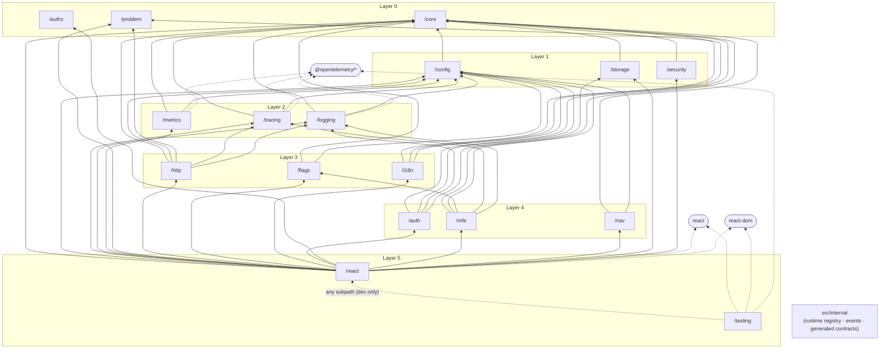

---

## Runtime registry

The `PlatformRuntime` lives on `globalThis[Symbol.for('@bcbp-solutions-fzc-llc/frontend-sdk')]`, so every copy of the SDK on a page finds the same object. That's how a remote sees the shell's identity, consent, session, flags, permissions and token source, even though the remote never imports the shell. Change notification goes through the runtime too. `/i18n`, `/flags`, `/authz` and `/http` emit the topics `i18n`, `flags`, `authz` and `read-only`, and `/react` re-renders on them.

A second copy is a remote that bundled the SDK instead of taking it from the shell. It logs one error. If its version is compatible (the same major, or for a pre-release the same version: `1.0.0-alpha.3` and `alpha.4` each keep their own), it binds to the existing runtime; otherwise it keeps its own. State a newer copy adds (the remote container cache, the flag subscription, the before-reload listeners) is created on first use, so an older copy's runtime still works.

> Source: [`docs/architecture/mermaid/runtime-registry.mmd`](docs/architecture/mermaid/runtime-registry.mmd)

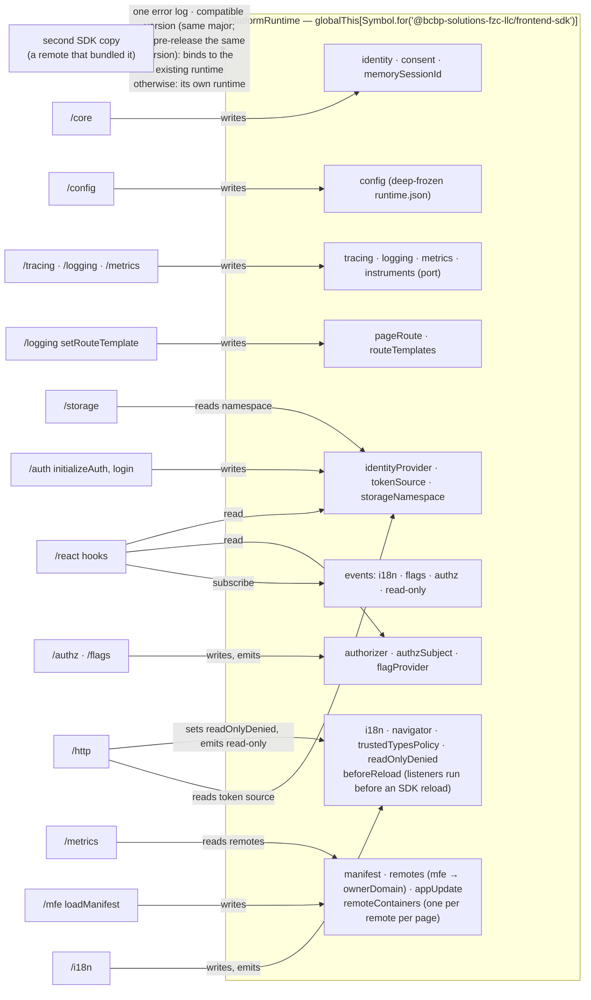

---

## Shell bootstrap

The shell runs the bootstrap once (a remote's code inside a shell never does) (design doc §C2). Steps 2–3 are fatal: they fall back to a static page, and no SDK telemetry is possible yet. Step 5 is never fatal. Step 7 is fatal only for routes that need auth. If step 9 fails, every remote slot shows its fallback. `examples/shell/src/bootstrap.tsx` follows the §C4 code; when step 8 failed transiently, the shell renders deny-all and retries P-35 in the background (`examples/shell/src/session-context.ts`). A sign-out in any tab during the steps stops the bootstrap before the app is mounted.

> Source: [`docs/architecture/mermaid/shell-bootstrap.mmd`](docs/architecture/mermaid/shell-bootstrap.mmd)

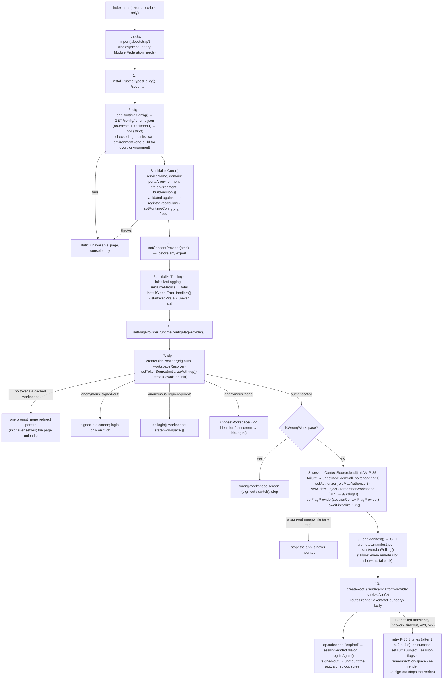

Remote code that also runs inside a shell skips all of this and reads the config only through `tryGetConfig()`. A remote's own standalone page (no shell) is its host page: it may run steps 2–3 itself (`initializeCore`, `loadRuntimeConfig`, `setRuntimeConfig`) and read `auth.signInUrl` to send a signed-out user to the shell. Without them every API returns a no-op or an anonymous default (`denyAll`, empty flags, the console logger).

---

## Request flow

`createApiClient({ mfe })` (or `useApiClient()`, bound to the nearest MFE scope) produces calls built from **route templates** (`'/tenders/:id'` + `params`), so the template is both the URL builder and the metric's `route` label. One logical call is one span and one metric observation, after retries.

> Source: [`docs/architecture/mermaid/request-flow.mmd`](docs/architecture/mermaid/request-flow.mmd)

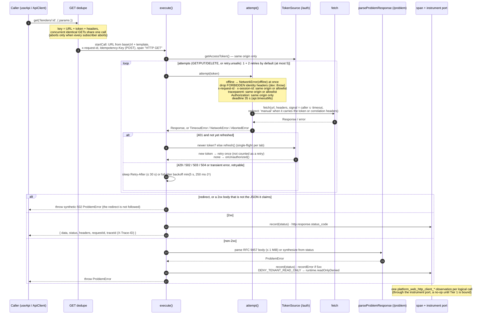

| Header | Sent to |
|---|---|
| `Authorization: Bearer` | the page's own origin only |
| `x-request-id`, `x-session-id`, `traceparent` / `tracestate` | the page's origin and the exact origins in `api.propagationAllowlist` / tracing's allowlist |
| `Idempotency-Key` | every `POST` (an automatic UUID unless given) |
| `x-user-id`, `x-tenant-id`, `x-tenant-roles`, `x-departments`, `x-plan`, `x-feature-flags`, `x-residency-mode` | **never**: dropped with a warn log, and a `TypeError` in local/dev |

---

## Workspace resolution before sign-in (PUB-1)

Every paid tenant has its own Keycloak realm (`tenant-<slug>`), and trial tenants share one (`trial`). The authorize URL names the realm, so the SDK must know the workspace **before** the redirect. `chooseWorkspace` decides it from the URL, the workspace cache and PUB-1. PUB-1 is called through the shell's `WorkspaceResolver` port over an `ApiClient`, without a token. A resolved realm is accepted only if it fits the slug, so a wrong or hostile answer can't send the user to another tenant's login page.

> Source: [`docs/architecture/mermaid/workspace-resolution.mmd`](docs/architecture/mermaid/workspace-resolution.mmd)

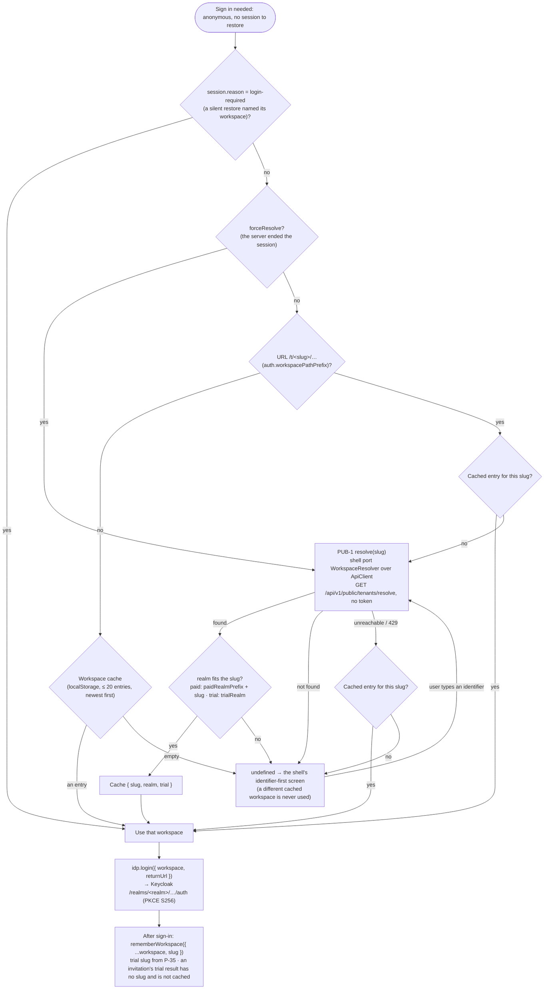

| Situation | Workspace used |
|---|---|
| A silent restore failed with `login_required` | The workspace it tried |
| The server ended the session (`forceResolve`) | PUB-1 again, skipping the cache |
| `/t/<slug>/…`, cached | The cached entry |
| `/t/<slug>/…`, not cached | PUB-1; cached when the realm fits |
| PUB-1 unreachable or rate-limited | The cached entry for that slug, else the identifier-first screen |
| PUB-1 says "not found" | The identifier-first screen; never another cached workspace |
| No slug in the URL | The most recent cached workspace, else the identifier-first screen |

After sign-in the shell calls `rememberWorkspace`, with the trial slug taken from P-35. A trial workspace reached from an invitation email has no slug and is never cached. LLD §8.2.

---

## Authentication: login and callback

Keycloak runs on `auth.bcbpsolutions.com` (not proxied, design doc §D4), with one realm per paid tenant (`tenant-<slug>`) and the shared `trial` realm. Endpoints are built from Keycloak's fixed paths, with no discovery fetch. The realm comes only from a `Workspace` that `chooseWorkspace` checked against `paidRealmPrefix` or `trialRealm`.

> Source: [`docs/architecture/mermaid/auth-login-callback.mmd`](docs/architecture/mermaid/auth-login-callback.mmd)

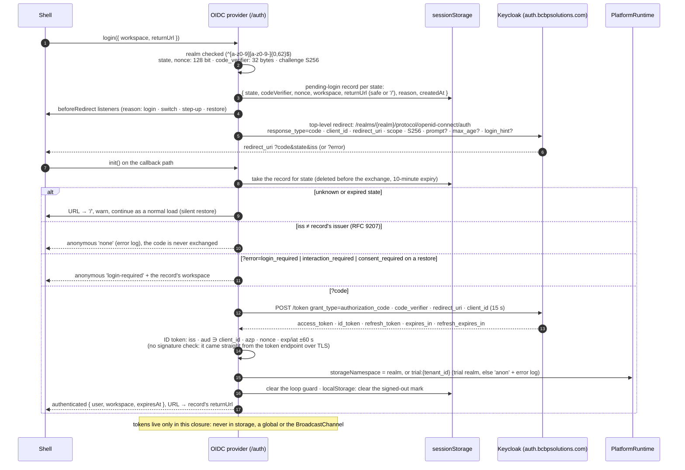

The callback always lands on the fixed `redirectPath`. `init()` replaces the URL with the record's `returnUrl` (it must pass `isSafeRedirect`, else `/`) before it resolves, so the shell never sees the callback path.

---

## Session lifecycle

Every full page load starts with no tokens: they live only in memory, and the cross-tab channel never carries one. So `init()` restores with one silent `prompt=none` round trip to the cached workspace. `tender-web` rotates refresh tokens with max reuse 0, and Keycloak tracks reuse per lineage (verified, design doc §D6 L). So every tab has its own lineage and **never sends a refresh token that has already been replaced**. Doing so would revoke the SSO session for every tab.

> Source: [`docs/architecture/mermaid/auth-refresh-restore.mmd`](docs/architecture/mermaid/auth-refresh-restore.mmd)

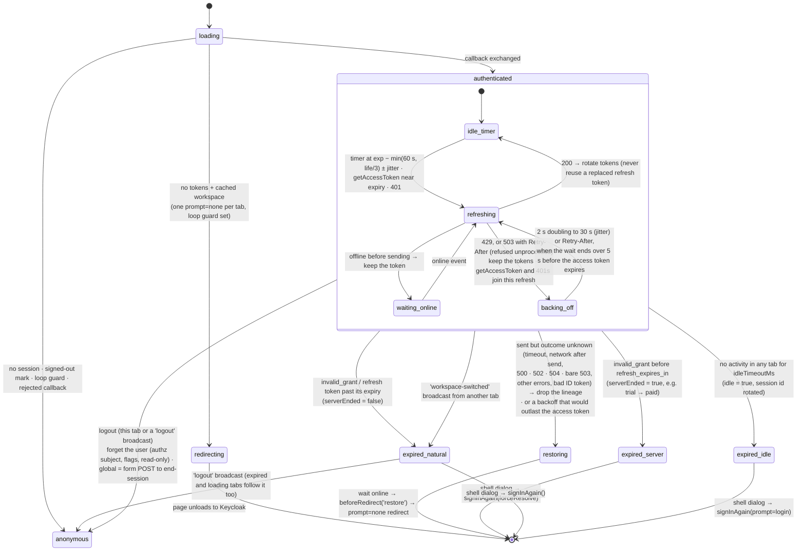

| Mark | Storage | Set | Cleared |
|---|---|---|---|
| Pending-login record (per `state`) | sessionStorage | before every authorize redirect | at the callback (before the exchange); expired after 10 min |
| Loop guard (one `prompt=none` per tab) | sessionStorage | before a silent redirect | when `init()` ends `authenticated` |
| Signed-out mark | localStorage (all tabs) | `logout()` | the next successful callback |
| Last activity (idle timeout) | localStorage (all tabs) | activity events, debounced to 5 s | — |
| Workspace cache (slug → realm, trial) | localStorage | `chooseWorkspace` (resolved slug) · `rememberWorkspace` | never by `clearAllAppStorage` |

---

## Remote loading

The shell loads `/remotes/manifest.json` once. Routes render `<RemoteBoundary remote module>`, which lazily calls `loadRemote` inside `Suspense` and an `MFEErrorBoundary`. Container globals follow one rule shared by `loadRemote` and `@bcbp-solutions-fzc-llc/webpack-preset`'s `containerName`: `__platform_mfe_` plus the remote's name, with `-` replaced by `_` (never the bare name: an element `id` or a browser global of that name would shadow it). `loadRemote` adds the entry script unless that global already holds a container.

> Source: [`docs/architecture/mermaid/remote-loading.mmd`](docs/architecture/mermaid/remote-loading.mmd)

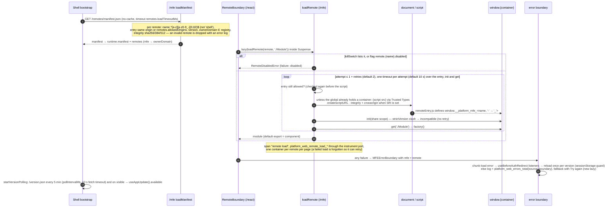

Sharing: the shell provides React, react-dom, `@opentelemetry/api` (`~1.10.0`) and every SDK subpath except `/testing` as strict singletons (`platformShared`). Remotes take the SDK with `import: false`, so they never bundle it. A remote that requires an SDK version the shell does not provide (`^<the version it was built against>`) fails share negotiation, which shows as a `RemoteLoadError` in its own boundary, not as a broken shell.

---

## Error handling (RFC 9457)

Every non-2xx answer becomes a `ProblemError`. Platform services send `application/problem+json`; anything else is synthesized from the status, and its body is never surfaced. The SDK matches types by `typeId` (`{domain}/{error}`), never by the full URI, title or detail. See [docs/problem-details](docs/problem-details/README.md).

> Source: [`docs/architecture/mermaid/error-handling.mmd`](docs/architecture/mermaid/error-handling.mmd)

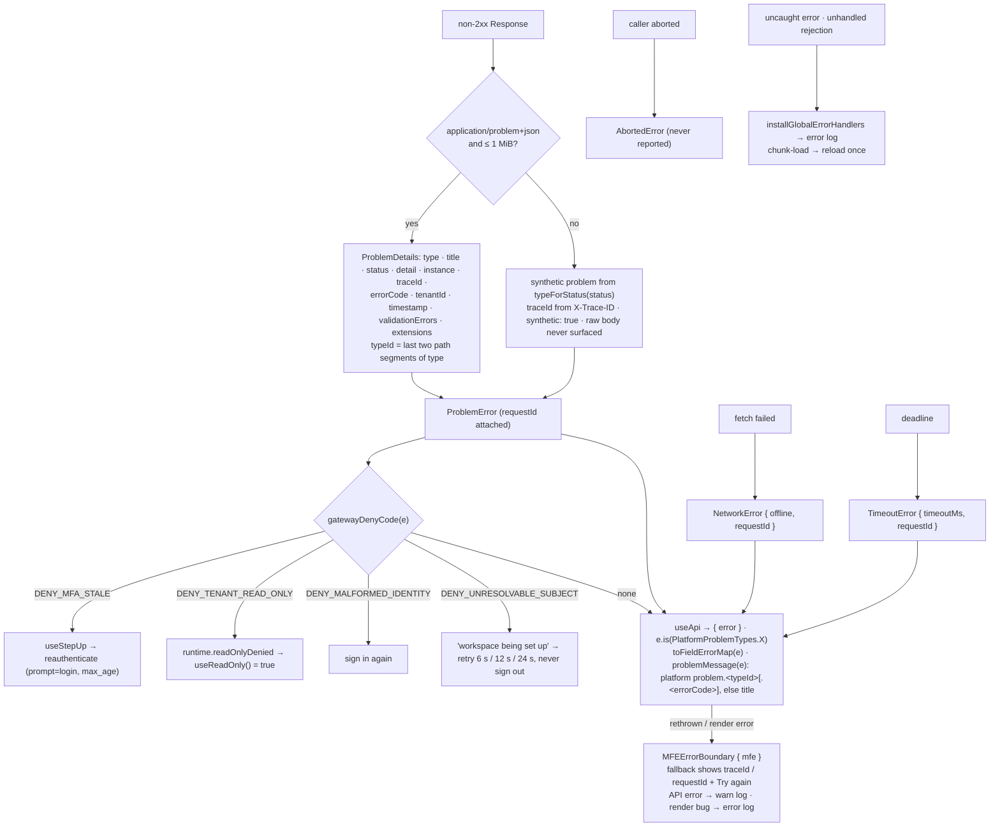

---

## Integration touchpoints

Everything the SDK calls outside the page, and what happens when it fails. All of it is same-origin through CloudFront except Keycloak. Only a missing `runtime.json` stops the page; every other failure degrades a part of it.

> Source: [`docs/architecture/mermaid/integration-touchpoints.mmd`](docs/architecture/mermaid/integration-touchpoints.mmd)

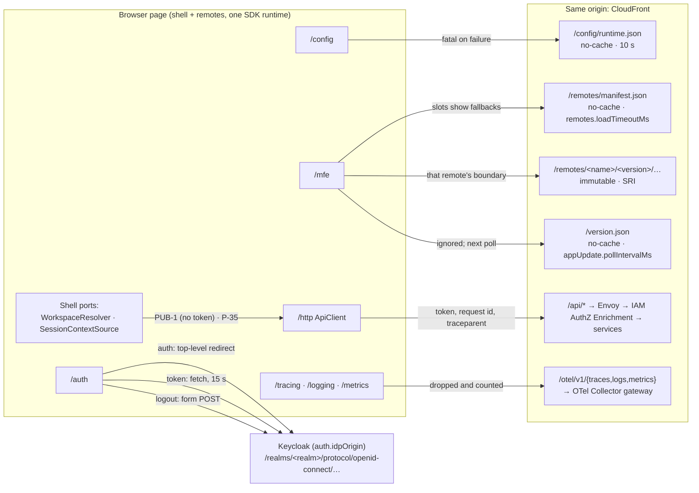

| Call | Made by | When | Bound | On failure |
|---|---|---|---|---|
| `GET /config/runtime.json` | `loadRuntimeConfig` | Bootstrap step 2 | 10 s | Fatal: the static "unavailable" page |
| Keycloak `…/auth` | `login`, silent restore (`prompt=none`), step-up, switch | Top-level redirect | — | `?error=` on the callback → `anonymous` |
| Keycloak `…/token` | Code exchange, refresh | `fetch` | 15 s | Exchange: `anonymous`. Refresh: 429 or 503 with `Retry-After` → backoff with tokens kept; anything ambiguous → lineage dropped, silent restore |
| Keycloak `…/logout` | `logout()` (global by default) | Hidden form POST | — | The local sign-out has already happened |
| PUB-1 `GET /api/v1/public/tenants/resolve` | Shell `WorkspaceResolver` | Before sign-in | `api.timeoutMs` | Cached entry for the slug, else the identifier-first screen |
| P-35 `GET /api/v1/me/session-context` | Shell `SessionContextSource` | After sign-in | `api.timeoutMs` | Deny-all permissions, platform flags only; the example shell retries a transient failure 3 times |
| `/api/*` | `ApiClient` | App calls | `api.timeoutMs` (35 s) per attempt | Idempotent calls retried (default 2, at most 5); RFC 9457 `ProblemError` |
| `GET /remotes/manifest.json` | `loadManifest` | Bootstrap step 9 | `remotes.loadTimeoutMs` | Every remote slot shows its fallback |
| `remoteEntry.js` and chunks | `loadRemote` | A slot's first render | `remotes.loadTimeoutMs` per attempt, `remotes.retries` | That remote's boundary fallback |
| `GET /version.json` | `startVersionPolling` | Every `appUpdate.pollIntervalMs` | — | Ignored until the next poll |
| `POST /otel/v1/{traces,logs,metrics}` | The exporters | Batches, page hide, `pagehide` | Bounded queues, 60 KiB keepalive budget | Dropped and counted |

---
## Cache strategy

The SDK never caches an API response: identical GETs in flight share one request, and nothing outlives the response. What it keeps is what a page or the next sign-in needs, each with a bound. Tokens are memory-only on purpose, so every page load restores the session with one silent round trip instead of reading a stored token.

> Source: [`docs/architecture/mermaid/cache-strategy.mmd`](docs/architecture/mermaid/cache-strategy.mmd)

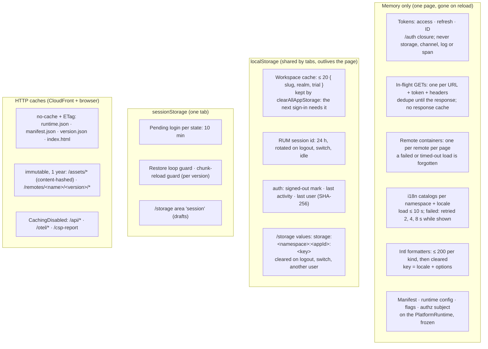

| Cache | Where | Bound | Cleared or refreshed by |
|---|---|---|---|
| Tokens | `/auth` closure | Access token lifetime; refreshed 60 s before expiry (at most a third of the lifetime), ± up to 10 s | Logout, switch, expiry, page unload |
| In-flight GETs | `/http` | Until the response | Each subscriber's abort; the fetch aborts when all have |
| Remote containers | `PlatformRuntime` | One per remote per page | A failed or timed-out load is forgotten |
| i18n catalogs | `/i18n` | One per namespace and locale | `setLocale`; a failed load retried 2, 4 and 8 s later while shown |
| Intl formatters | `/i18n` | 200 per kind, then cleared | — |
| Workspace cache | localStorage | 20 entries, newest first | Kept on logout: the next sign-in needs it |
| RUM session id | localStorage | 24 h | Logout, workspace switch, idle timeout |
| `/storage` values | local or session | Per workspace namespace | Logout, switch, a different user signing in |
| Pending login | sessionStorage | 10 min per `state` | The callback deletes it before the exchange |
| `runtime.json`, manifest, `version.json`, `index.html` | HTTP | `no-cache` + ETag | Every load revalidates |
| `/assets/*`, `/remotes/<name>/<version>/*` | HTTP | Immutable, 1 year | A new build has new names |

---
## Data model

The SDK has no server-side data. Its state is in three places, all on the user's device: the `PlatformRuntime` object (memory, one per page, shared by every SDK copy), `localStorage` (shared by the tabs of one origin) and `sessionStorage` (one tab). Two files configure it: `runtime.json` and the remote manifest. Their schemas are strict, and the full key lists are LLD §12.1 (`runtime.json`) and §12.3 (storage keys).

> Source: [`docs/architecture/mermaid/data-model.mmd`](docs/architecture/mermaid/data-model.mmd)

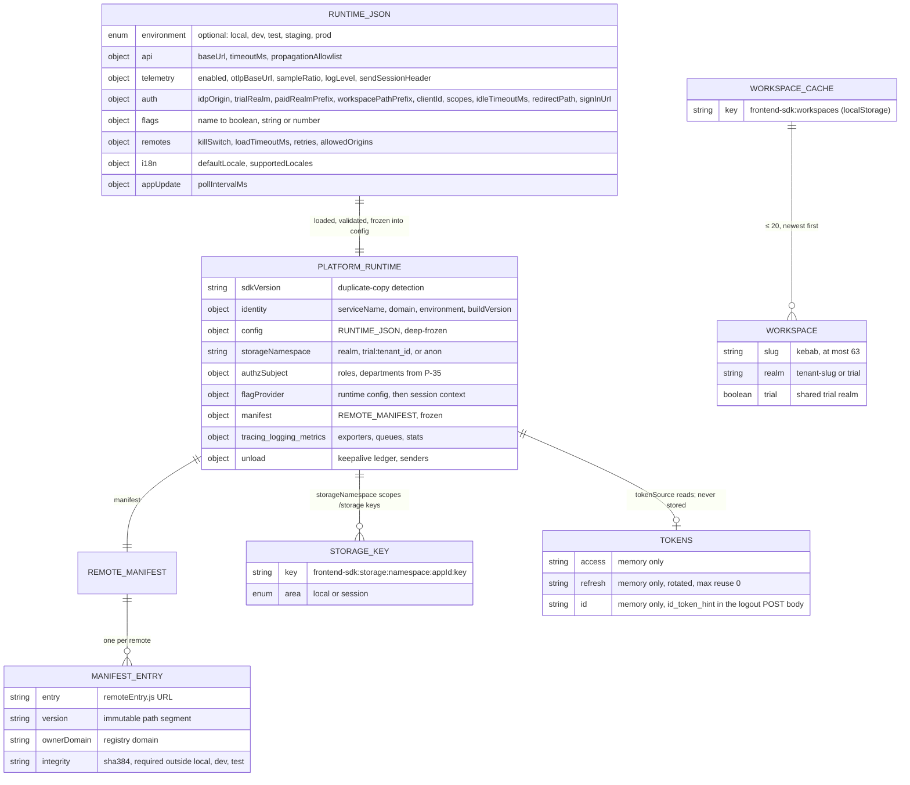

- **Reserved keys** are under `@bcbp-solutions-fzc-llc/frontend-sdk:`. App code reaches storage only through `storage(appId)`, which adds the workspace namespace (lint rule `no-raw-storage`).
- **Tokens are not in the model.** They exist only inside the `/auth` closure; `/storage` refuses token-like keys, and tests scan storage and the channel for them.
- **`runtime.json` is validated strictly:** an unknown key, a wrong type or an http origin outside local, dev and test fails the load with every offending path named.

---
## Cross-tab and in-page events

Two event paths, neither carrying data a later reader could misuse. Between tabs, `BroadcastChannel('platform-auth')` carries two message types, `logout` and `workspace-switched`, and `localStorage` shares the signed-out mark and the last activity time. Inside a page, the `PlatformRuntime` publishes five topics that the `/react` hooks subscribe to, so a change made by the shell (or by another tab's sign-out) re-renders every remote without them importing the shell.

> Source: [`docs/architecture/mermaid/cross-tab-events.mmd`](docs/architecture/mermaid/cross-tab-events.mmd)

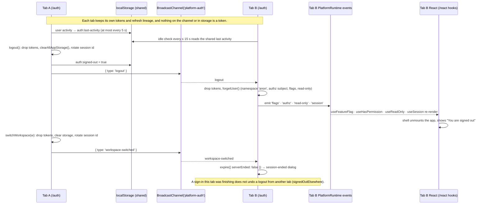

| Signal | Path | Effect |
|---|---|---|
| `logout` | Channel | The receiving tab drops its tokens and forgets the user, then shows "You are signed out" |
| `workspace-switched` | Channel | The receiving tab expires its session (`serverEnded: false`): the session-ended dialog |
| `auth:signed-out` | localStorage | The next sign-in in any tab uses `prompt=login`, never the live SSO session |
| `auth:last-activity` | localStorage | Idle timeout counts activity in every tab (written at most every 5 s, checked every ≤ 15 s) |
| `session` | Runtime topic | `useSession`, `useCurrentUser`, `useWorkspace` |
| `flags` | Runtime topic | `useFeatureFlag` |
| `authz` | Runtime topic | `useHasPermission`, `<Can>` |
| `read-only` | Runtime topic | `useReadOnly` |
| `i18n` | Runtime topic | `useT`, `useLocale` |

Listeners are snapshotted before they are notified, and a throwing listener never stops the others. Without `BroadcastChannel`, other tabs learn of a sign-out at their next refresh.

---

## Telemetry pipeline

Logs, traces and metrics leave the page over OTLP/HTTP to the same-origin `/otel` path. CloudFront forwards it to the OTel Collector; there is no Faro SDK and no second pipeline. When the page is hidden or closing, the three signals share one 60 KiB keepalive budget in a fixed order (metrics' share, logs, spans), and every request that must outlive the tab starts inside the listener (`src/internal/unload`, LLD §7.5). The reference Collector configuration is two-tier (`examples/collector`, LLD §7.6): a gateway that scrubs, allowlists and routes each metric stream to one aggregator, which converts delta to cumulative. Everything is redacted with the same rules as gincommon's log sanitizer, gated on consent, and queued with fixed bounds, so a slow or unreachable collector costs a fixed amount of memory. Nothing is printed to the console outside local and dev while logging runs; before it starts, with telemetry off, or on a remote's standalone page (no collector), `warn` and `error` go to the console, redacted (LLD §7.2). See [docs/observability](docs/observability/README.md).

> Source: [`docs/architecture/mermaid/telemetry-pipeline.mmd`](docs/architecture/mermaid/telemetry-pipeline.mmd)

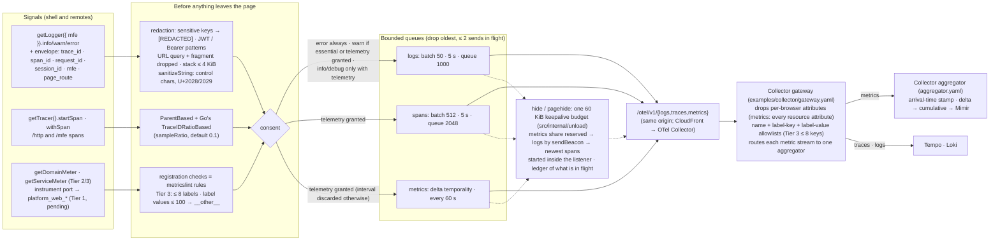

Identity on every signal is the **page** identity (`initializeCore`: `domain` / `service` / `environment`, e.g. `portal` / `web-app`). Remotes are told apart by the `mfe` attribute or label, never by a second `domain`. The one exception is a remote's own Tier 2/3 metrics, which carry its manifest `ownerDomain` (design doc §D1).

---

## Workspace isolation in the browser

The browser counterpart of the services' row-level security. One device can be used by several people and several workspaces, so everything the SDK stores for an app is scoped to the signed-in workspace and removed when that person leaves. The gateway enforces the real tenant isolation; this keeps one tenant's leftovers out of the next session on the same device.

> Source: [`docs/architecture/mermaid/workspace-isolation.mmd`](docs/architecture/mermaid/workspace-isolation.mmd)

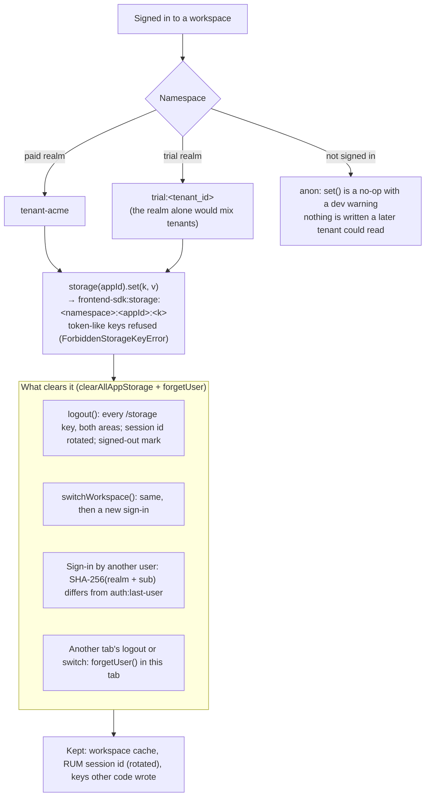

| Rule | Mechanism |
|---|---|
| Keys are per workspace | Namespace = paid realm, or `trial:<tenant_id>` in the shared trial realm, or `anon` before sign-in |
| Nothing is written before sign-in | `set()` in `anon` is a no-op with a dev warning |
| A sign-out removes everything | `clearAllAppStorage()` (both areas, every workspace and app, keys from `alpha.3` and earlier too), session id rotated, signed-out mark set, other tabs told |
| A different person clears the previous one's data | SHA-256 of realm + `sub` compared with `auth:last-user` at sign-in |
| Another tab's sign-out reaches this tab | `forgetUser()`: namespace `anon`, authz subject, flags and read-only cleared |
| No credentials in storage | Token-like keys refused (`ForbiddenStorageKeyError`) |

---

## Contracts and drift control

Nothing backend-shaped is written by hand. Constants, vocabularies, rules and fixtures are generated from backend commits pinned in `contracts/sources.json`, and CI fails when they drift. Moving a pin is a reviewed change: `pnpm contracts:sync --update-pins`, then review the generated diff.

> Source: [`docs/architecture/mermaid/contracts-drift.mmd`](docs/architecture/mermaid/contracts-drift.mmd)

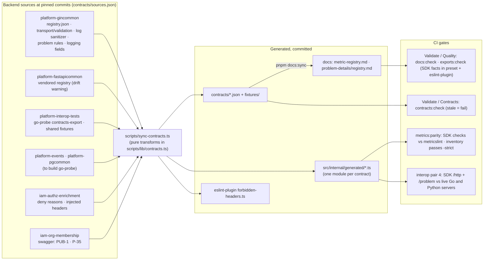

---

## CI and release

`.github/` mirrors platform-gincommon's pipeline: the same job names and gates. gincommon's image jobs (build, Trivy, smoke) map to this repo's three npm packages: pack them, scan the files and lockfile, smoke-test the tarballs.

> Source: [`docs/architecture/mermaid/ci-pipeline.mmd`](docs/architecture/mermaid/ci-pipeline.mmd)

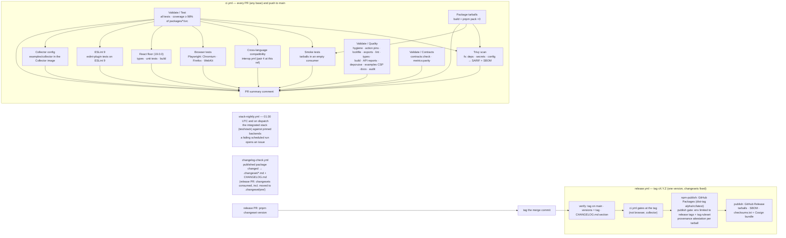

---

## Concurrency model

The browser is single-threaded; concurrency here means overlapping promises and several tabs.

| Concern | Mechanism |
|---|---|
| Concurrent identical GETs | One in-flight call per key (URL + token + headers); the shared fetch is aborted only when every subscriber has aborted |
| Token refresh | One in-flight `refresh()` per tab; the timer, `/http`'s 401 path and direct callers await the same promise, including its backoff after a 429 or a 503 with `Retry-After`; a new refresh starts only after it settles, with the token it returned |
| Tabs | One refresh lineage per tab, never shared; `BroadcastChannel('platform-auth')` carries only `logout` and `workspace-switched`; idle activity and the signed-out mark are shared through localStorage |
| Remote containers | One container per remote per page, cached on the runtime (shared by SDK copies); concurrent `loadRemote` calls share it; a failed or timed-out load is forgotten so a retry starts fresh |
| i18n catalogs | One in-flight load per namespace and locale |
| Telemetry export | At most two sends in flight per signal; beyond the queue bound the oldest items are dropped and counted |
| Runtime listeners | Snapshot before notify; a throwing listener never stops the others |

## Failure domains

| Failure | Effect | What still works |
|---|---|---|
| `runtime.json` unreachable, invalid or slower than 10 s | Fatal at bootstrap (static page) | — |
| `/otel` down or slow | Queues fill, oldest dropped, failures counted | Everything else; no retries into a struggling page |
| Keycloak unreachable during refresh | Ambiguous outcome (network error, 500, 502, 504, bare 503) → lineage dropped → silent restore after `online` | Calls fail with 401/`NetworkError` meanwhile; no sign-out |
| Keycloak shedding load (429, or 503 with `Retry-After`) | Tokens kept; the refresh retried with backoff while the access token stays valid, then a silent restore | Calls wait for the refresh, then carry the token |
| Session ended by the server (`invalid_grant`) | `expired { serverEnded: true }` → dialog → re-resolve the workspace | Drafts saved by `beforeRedirect` listeners |
| P-35 session context fails | Deny-all permissions, platform flags only, workspace not cached; the example shell retries a transient failure 3 times (1 s, 2 s, 4 s) | Signed-in shell |
| Manifest fails or times out | Every remote slot shows its fallback | Shell routes |
| A remote fails to load or render | That remote's boundary fallback with `traceId` / Try again | Shell and other remotes |
| Old chunks gone after a deploy | One reload per version (sessionStorage guard), after the `useBeforeAuthRedirect` listeners | Drafts those listeners saved |
| Consent not granted | Only `error` logs and essential `warn` logs leave the page | All functionality |
| localStorage / sessionStorage blocked | Session id per page; storage kept in memory; **sign-in impossible** (no pending-login record), stated, never silent | Anonymous pages |

## Key invariants

| Invariant | Where enforced |
|---|---|
| Tokens are never in storage, a global, a log or the channel | `/auth` closure; `/storage` refuses token-like keys; redaction of JWT/Bearer patterns; auth tests scan storage |
| The browser never sends identity headers | `/http` drops `FORBIDDEN_REQUEST_HEADERS` (generated from gincommon + AuthZ Enrichment); `@bcbp-solutions-fzc-llc/eslint-plugin` `no-identity-headers`; interop pair 4 |
| The access token goes to the page's own origin only | `/http` `isSameOrigin` check before `Authorization` |
| A replaced refresh token is never sent | single-flight `refresh()`; ambiguous failures drop the lineage instead of retrying; only an answer that says it was not processed (429, 503 with `Retry-After`) is retried with the same token |
| Metric `route` labels are templates, never raw URLs | `ApiClient` takes templates; `api-route-template` lint rule |
| Metric names, labels and units follow the registry | `/metrics` registration checks = gincommon `metricslint` rules (`metrics:parity` in CI) |
| One page identity; remotes never set `domain` | `/core` `initializeCore` once; `IdentityMismatchError` on a different second call |
| Nothing leaves the page without consent (except errors) | consent gates in the log, span and metric pipelines |
| No `eval`, no inline script (CSP `script-src 'self'`) | preset (no eval devtools, `environment.globalThis`); Zod jitless; `examples:check`; `no-eval` lint |
| Untrusted HTML only through DOMPurify + Trusted Types | `/security` `sanitizeHtml`; `no-unsafe-html` lint |
| A remote never bundles the SDK | `sharedFor('remote')` `import: false`; `examples:check` |
| A build uses the SDK its preset was made for | `SdkVersionPlugin` in every preset |
| The ID token never lands in a URL | Global sign-out is a form POST (`id_token_hint` in the body); CSP `form-action` allows the IdP origin |
| Contracts are generated, never edited | `contracts:check`, `docs:check` in CI |

## Deployment

Nothing in this repository is deployed. It publishes three packages (see *Release and distribution*), and each app built with them is deployed by its own pipeline to S3 behind CloudFront. `examples/cloudfront` holds what that infrastructure must do, tested here: the response headers (`csp.mjs`), the SPA rewrite, the `/csp-report` Lambda and the behaviors table.

> Source: [`docs/architecture/mermaid/deployment.mmd`](docs/architecture/mermaid/deployment.mmd)

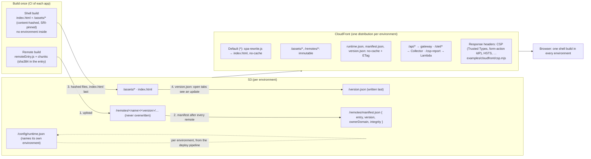

- **Build once.** The shell build carries no environment: `runtime.json` names it, so one build is promoted through every environment. Each environment's deploy writes its own `runtime.json`, and its pipeline should check `environment` equals the target (LLD §15).
- **Deploy order.** Remotes under a new `/remotes/<name>/<version>/` (never overwritten), then the manifest with each entry's `integrity`, then the shell (hashed files first, `index.html` last), then `/version.json`, which tells open tabs to update.
- **Chain of trust.** The manifest's sha384 pins `remoteEntry.js`, which pins each of its chunks (`ChunkIntegrityPlugin`). `index.html` pins the shell's scripts and stylesheets.
- **Headers.** The CSP allows scripts from `'self'` only, requires Trusted Types (policies `platform-sdk`, `platform-webpack`, `dompurify`) and lets `form-action` reach the IdP origin for the sign-out POST.

---

## Release and distribution

All three packages share one version (`fixed`). The release flow:
1. A release PR runs `pnpm changeset version`.
2. The merge commit is tagged `vX.Y.Z`.
3. `release.yml` verifies the tag and versions and reruns the `ci.yml` gates at the tag (all but `browser` and `collector`).
4. `npm-publish` publishes the three packages to **GitHub Packages** (`@bcbp-solutions-fzc-llc/*`), with a build-provenance attestation each, only if publishing is gated: required reviewers, or (this private repository on GitHub Team) an `npm` environment limited to release tags plus a tag ruleset over who may push them (`check-npm-environment.sh`).
5. A **GitHub Release** carries the tarballs, a CycloneDX SBOM and Cosign-signed checksums.

The first release is `v1.0.0-alpha.1` (2026-11-03); `v1.0.0-alpha.4` (2026-11-05)'s breaking changes (the container global, the `/storage` key prefix, the CSP `form-action` for the sign-out POST, at most 8 Tier 3 labels, stricter lint rules) mean the shell and every remote upgrade together. `v1.0.0-alpha.5` (2026-11-05) added the optional `auth.signInUrl`. The latest is `v1.0.0-alpha.6` (2026-11-05, not breaking, the shell upgrades first): `runtime.json` names the `environment`, so one shell build serves every environment; `formatDate` takes calendar dates; `warn` and `error` reach the console while logging is not running.

During the alpha, versions are `1.0.0-alpha.N`. The shell shares the SDK under `^1.0.0-0`; each remote requires `^<the SDK version it was built against>`, so a shell with an older SDK refuses it at share negotiation. `1.0.0` is cut with the first environment, and SemVer is strict from then on (design doc §C3 "Versioning").

## Testing strategy

| Layer | How |
|---|---|
| Unit | Vitest per subpath (`test/unit/<subpath>`). Node by default; `happy-dom` for React; `jsdom` for DOMPurify. Coverage gate ≥ 98 % statements of `packages/*/src` (`pnpm test`: 1530 tests in 61 files, 98.7 %) |
| Integration / E2E | `test/integration`: subpaths wired together; `test/e2e`: the reference shell and remote booted end to end (both in-process, jsdom) |
| Browser | `test/browser`: Playwright in Chromium, Firefox and WebKit under the production CSP: the keepalive budget on hide and tab close, page-lifecycle event order, SRI on lazy JS and CSS chunks (webpack and Rspack builds of the example remote and of `styled-remote/`), `AbortSignal.any` native and absent, Trusted Types (CI job `browser`); engine limits in `engine-notes.ts` |
| Collector | `test/collector`: the reference two-tier Collector (`examples/collector`) in the Collector image, two gateways and two aggregators: per-stream routing, totals across device clocks, allowlists (`pnpm test-collector`, CI job `collector`); `examples/collector/test` keeps the allowlists equal to the registry |
| Integrated | `test/stack`: the example shell in three engines against Keycloak, Envoy with the real IAM services, the distribution on floci and the two-tier Collector (`docker-compose.yml`); nightly in CI (`stack-nightly.yml`); findings in `docs/e2e/integrated-deployment-report.md` |
| React floor | The typecheck, unit suite, build and example checks on React 19.0.0 (CI job `react-floor`) |
| ESLint floor | The eslint-plugin's tests on ESLint 9, the lower major of its peer range (CI job `eslint-9`, `.github/scripts/eslint-9.sh`) |
| Smoke | `test/smoke`: the example builds served with the CloudFront headers and rewrite, or a deployed shell (`SMOKE_BASE_URL`) |
| Contract | Shared fixtures from platform-interop-tests (headers, identity, redaction, problem bodies) and the PUB-1 / P-35 cases, run by the SDK and by the example shell's ports |
| Fake backends | A Keycloak fake at the HTTP level (PKCE, rotation, reuse revokes the session); `mockApi` / `mockProblem` |
| Parity | `metrics:parity`: SDK registration checks vs gincommon `metricslint`, inventory passes `-strict` |
| Cross-language | interop-tests pair 4: the SDK's `/http` + `/problem` against the live Go and Python servers |
| Build output | `examples:check` (CSP, container global, no SDK in remotes); real webpack, Rspack and Rsbuild builds in the preset's tests, including webpack and Rspack shells and remotes mixed; the browser SRI suite runs on a webpack-built and an Rspack-built remote |
| Package | Smoke tests of the packed tarballs in an empty consumer project |

## Consumer conformance checklist

A shell or remote conforms when:

- It imports SDK subpaths only (`@bcbp-solutions-fzc-llc/eslint-plugin` `configs.recommended` passes).
- It builds with `platformWebpackConfig({ role, name, exposes })`, `platformRspackConfig(…)` or Rsbuild's `pluginPlatform(…)`, and adds no other shared config for React, OTel or the SDK (with Rsbuild: no `moduleFederation` option).
- **Shell:**
  - it runs the bootstrap in order, implements `WorkspaceResolver` and `SessionContextSource` as ports, and passes the PUB-1/P-35 contract cases;
  - it shows its own signed-out, session-ended and wrong-workspace screens, and never signs in automatically after a logout;
  - it is built once for every environment: it loads `runtime.json` before `initializeCore` and takes `environment` from it, and each environment's deployed `runtime.json` sets its own `environment` (the deploy pipeline checks it matches the target).
- **Remote:**
  - it wraps its root in `MFEErrorBoundary` (or is loaded through `RemoteBoundary`);
  - it uses `useApi` / `useApiClient` with route templates;
  - it registers its page templates (`useRouteTemplate`) and keeps drafts in `storage(appId, { area: 'session' })` from `useBeforeAuthRedirect`.
- Its own metrics use `getServiceMeter()` (Tier 3), and its CI runs `metricslint check` on `renderMetricInventory()`.
- It serves the CloudFront response headers of `examples/cloudfront` (CSP with the three Trusted Types policies, and `form-action` allowing the IdP origin).
- Its SDK and preset are the same version (`SdkVersionPlugin`); the shell and its remotes upgrade together across a breaking alpha.

## Schema lifecycle

Two kinds of schema. Backend-shaped data (registry vocabulary, log fields, redaction rules, problem types, header names, gateway deny codes, the PUB-1 and P-35 cases) is **generated** from pinned commits of the platform and IAM repositories (`contracts/sources.json`) and never edited by hand. The browser-facing schemas, `runtime.json`, the manifest and the public API, are owned here and change under versioning rules.

> Source: [`docs/architecture/mermaid/schema-lifecycle.mmd`](docs/architecture/mermaid/schema-lifecycle.mmd)

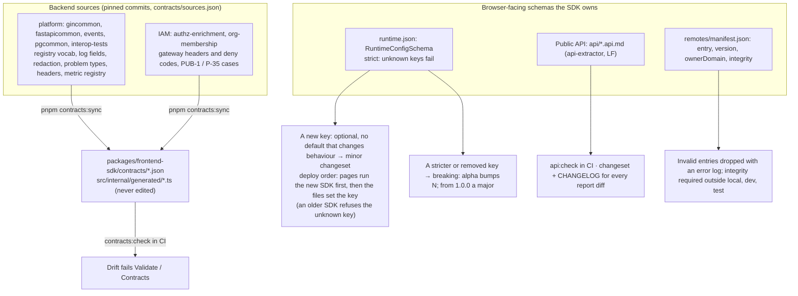

| Schema | Owner | Changes by | Check |
|---|---|---|---|
| `contracts/*.json`, `src/internal/generated/*` | Backend repos (pinned) | `pnpm contracts:sync` after moving a pin | `contracts:check` (Validate / Contracts) |
| `runtime.json` (`RuntimeConfigSchema`) | This repo | A new optional key is minor; a stricter or removed key is breaking | Unit tests; API report |
| `remotes/manifest.json` | This repo | As above | `loadManifest` drops an invalid entry with an error log |
| Public API (`api/*.api.md`) | This repo | Changeset + CHANGELOG for every diff | `api:check` |

A new `runtime.json` key reaches pages in two steps: the pages upgrade to the SDK that knows it, then the deployed files set it. An older SDK refuses the unknown key and stops at the "unavailable" page.

---

## Threat model

| Threat | Mitigation |
|---|---|
| XSS steals tokens | Tokens only in a closure (never storage); strict CSP (`script-src 'self'`, `require-trusted-types-for 'script'`); DOMPurify for any HTML |
| A forged identity header from the browser | Never sent by the SDK, lint-checked, and stripped by Envoy regardless |
| An authorization code reused or injected | PKCE S256; one-time pending record per `state`; RFC 9207 `iss` check; ID-token `nonce`/`aud`/`azp`/`iss`/time checks |
| A code from one realm exchanged at another | The `iss` check against the record's realm before any exchange |
| An open redirect after login | `returnUrl` must pass `isSafeRedirect` (same origin; no protocol-relative, backslash or control-character tricks) |
| Tenant data seen by another tenant on a shared browser | `/storage` namespaced by realm or `trial:<tenant_id>` under the SDK's key prefix; `clearAllAppStorage` on logout and switch, with the UI permissions, flags and read-only mark; other tabs follow, expired and loading ones included; `anon` writes are no-ops |
| A malicious remote entry | Manifest entries limited to same origin or exact allowed origins, checked again before the script; SRI on the entry when given and on every lazy JS and CSS chunk; kill switch |
| Telemetry leaking secrets or PII | Redaction (sensitive keys, JWT/Bearer, URL queries in every string and span attribute), bounded stack and attribute size, consent (withdrawing it drops what is queued); the Collector gateway drops per-browser attributes |
| The ID token (name, email) in the browser history or an access log | Global sign-out POSTs it in a form body, never a URL query |
| Forged telemetry flooding the metrics backend (`/otel` is public) | The gateway allowlists metric names, label keys (Tier 3: snake_case, not prohibited, at most 8) and label values from the registry, cuts values at 128 characters, records a `page_route` over 64 as `unknown` and keeps no resource attribute on metrics; Mimir per-tenant series limits; WAF rate rules on `/otel` (`examples/cloudfront`) |
| A reload loop after a bad deploy or failed restore | Reload once per version; one `prompt=none` per tab |

## Developer tools

| Command | Purpose |
|---|---|
| `pnpm verify` | Everything CI's quality and test gates run, locally |
| `pnpm contracts:sync` / `contracts:check` | Regenerate / check `contracts/` from the pinned sources |
| `pnpm docs:sync` / `docs:check` | Regenerate / check the generated docs and the diagram blocks here |
| `pnpm api` / `api:check` | api-extractor reports per subpath |
| `pnpm exports:sync` | Exports map and the SDK facts in the tooling packages |
| `pnpm metrics:parity` | SDK checks vs gincommon `metricslint` |
| `pnpm examples:check` | CSP and sharing checks of the example builds |
| `pnpm changeset` | Record a change to a published package |

## Implementation decisions

Judgment calls made while implementing, where the design doc was silent or the integrated run showed it was wrong. Each is also recorded at its point in the code and in the CHANGELOG.

1. **The environment comes from `runtime.json`.** A build-time environment meant one shell build per environment. The host page loads the config first and passes `cfg.environment` to `initializeCore`. Only `loadRuntimeConfig`, which stores nothing, trusts the file's own environment; `setRuntimeConfig` before `initializeCore` does not, and `initializeCore` refuses another environment than a config already set. Otherwise a config could vouch for itself.
2. **A remote's standalone page is its own host page.** With no shell, it may call `initializeCore`, `loadRuntimeConfig` and `setRuntimeConfig`. Code that also runs inside a shell only reads (`tryGetConfig`). `auth.signInUrl` tells such a page where to send a signed-out user.
3. **Sign-out is global and a form POST.** A local sign-out left the Keycloak session alive, so the next person on a shared device was signed in as the previous one (integrated report Issue 10). A POST keeps the ID token, which carries the user's name and email, out of URLs and logs; it needs the IdP origin in CSP `form-action`.
4. **A refresh is retried only on 429, or 503 with `Retry-After`.** Those say the request was not processed. Retrying after a 502, a 504 or a bare 503 could reuse a refresh token Keycloak had already rotated, which revokes the whole session.
5. **The remote container global is `__platform_mfe_<name>`.** A bare name could be shadowed by an element id or a browser global.
6. **Pre-release SDK copies share the runtime only at the same version.** `alpha.N` may break `alpha.N-1`; sharing across them would mix incompatible state.
7. **`warn` and `error` reach the console while logging is not running.** A standalone page has no collector; before, its warnings were lost in test, staging and prod.
8. **`formatDate('YYYY-MM-DD')` formats in UTC.** A calendar date is a day, not an instant; `new Date('2026-10-25')` showed Oct 24 west of UTC.
9. **API reports use LF.** api-extractor's CRLF default left the reports with mixed endings that flipped on regeneration.

---

## Documentation assets

Architecture diagrams live as standalone Mermaid files under `docs/architecture/mermaid/` and are embedded into this document verbatim, each under a `> Source:` link back to its `.mmd` file, so a diagram only has to be correct in one place. `pnpm docs:sync` writes the blocks; `pnpm docs:check` fails CI when they drift.

> Source: [`docs/architecture/mermaid/documentation-assets.mmd`](docs/architecture/mermaid/documentation-assets.mmd)

```mermaid
graph LR
    subgraph sources["Documentation sources"]
        design["docs/design/frontend-sdk-design.md<br/>decision record (HLD): what and why"]
        mmd["docs/architecture/mermaid/<br/>.mmd source diagrams (package-dependencies generated)"]
        arch["ARCHITECTURE.md<br/>embeds every .mmd verbatim + prose"]
        lld["docs/lld/platform-reactcommon-lld.md<br/>implementation as built"]
        obs["docs/observability/<br/>standard · metric-registry.md (generated) · migration · runbooks"]
        pd["docs/problem-details/<br/>RFC 9457 in the SDK · registry.md (generated)"]
        readme["README.md · package READMEs · contracts/README.md"]
        api["packages/frontend-sdk/api/*.api.md<br/>(api-extractor, per subpath)"]
        cs["CHANGELOG.md (one history, Keep a Changelog)"]
    end

    subgraph checks["Kept in sync by"]
        dsync["pnpm docs:sync / docs:check<br/>(Validate / Quality)"]
        apic["pnpm api:check"]
        csync["pnpm contracts:sync"]
    end

    subgraph rendered["Rendered / consumed by"]
        gh["GitHub — Markdown + Mermaid"]
        ide["IDE Mermaid preview · mermaid.live"]
        rel["GitHub Release notes"]
    end

    csync --> obs
    csync --> pd
    mmd --> dsync --> arch
    obs --> dsync
    pd --> dsync
    api --> apic
    arch --> gh
    design --> gh
    lld --> gh
    readme --> gh
    mmd --> ide
    cs --> rel
```

| Document | Description |
|---|---|
| [README.md](README.md) | Workspace layout, commands, CI and releases |
| [`docs/design/frontend-sdk-design.md`](docs/design/frontend-sdk-design.md) | The design and its decisions (HLD): public API per subpath, contracts, backend changes it relies on |
| [`docs/lld/platform-reactcommon-lld.md`](docs/lld/platform-reactcommon-lld.md) | Low-level design: the implementation as built, limits, algorithms, state, failure handling |
| [`docs/architecture/README.md`](docs/architecture/README.md) | Index of the `.mmd` diagrams embedded above |
| [`docs/observability/README.md`](docs/observability/README.md) | The observability standard as the SDK implements it |
| [`docs/observability/metric-registry.md`](docs/observability/metric-registry.md) | Generated: the registry the SDK validates against |
| [`docs/observability/migration.md`](docs/observability/migration.md) | Moving an existing app onto the SDK |
| [`docs/observability/runbooks.md`](docs/observability/runbooks.md) | Runbooks for frontend symptoms and the proposed web alerts |
| [`docs/problem-details/README.md`](docs/problem-details/README.md) | RFC 9457 in the browser |
| [`docs/problem-details/registry.md`](docs/problem-details/registry.md) | Generated: platform problem types and gateway deny codes |
| [`packages/frontend-sdk/api/`](packages/frontend-sdk/api/) | Public API per subpath (api-extractor) |
| [`packages/frontend-sdk/contracts/README.md`](packages/frontend-sdk/contracts/README.md) | What each generated contract is and where it comes from |
| [`examples/cloudfront/README.md`](examples/cloudfront/README.md) | CloudFront behaviors, deploy order, CSP |

Render a diagram locally in a Mermaid-aware IDE (VS Code + Mermaid Preview, IntelliJ + Mermaid plugin), or paste it into [mermaid.live](https://mermaid.live).
