# Architecture

This document describes the internal structure, dependency rules, and runtime flows of `platform-reactcommon`.

`platform-reactcommon` is a **private pnpm monorepo** of three packages, released together under one version (changesets `fixed`, `1.0.0-alpha.N` until the first environment):

- **`@platform/frontend-sdk`**: the shared TypeScript SDK every React micro-frontend (shell and remotes) uses. Its 17 subpaths are `/core` … `/react`, `/testing`, and there is no root barrel. It is **contract-compatible with platform-gincommon and platform-fastapicommon**:
  - the same identity vocabulary and metric registry (Enterprise Platform Observability Standard);
  - RFC 9457 Problem Details;
  - the header names, the redaction rules, and the Go trace sampler.

  It is the browser's side of IAM: Keycloak sign-in (Authorization Code + PKCE, tokens in memory only), workspace (realm) choice, session restore, idle timeout, step-up.
- **`@platform/webpack-preset`**: the Module Federation shared map (strict singletons, the SDK provided only by the shell) and CSP-safe output (Trusted Types, no `eval`, hidden source maps).
- **`@platform/eslint-plugin`**: seven rules that enforce in consumer code what the design requires:
  - SDK subpaths only;
  - no identity headers;
  - storage and HTML only through the SDK;
  - no runtime CSS-in-JS;
  - route templates for API paths.

`examples/` holds a reference shell, the tenders remote and the CloudFront/CSP snippets. None of it is deployed from here. The decisions behind all of this are in [`docs/design/frontend-sdk-design.md`](docs/design/frontend-sdk-design.md) (the decision record). This document and the [LLD](docs/lld/platform-reactcommon-lld.md) describe the implementation as built.

**Does not own:**
- **Authentication and authorization decisions:** the API gateway (Envoy + IAM AuthZ Enrichment) validates the token and injects identity; the browser never sends identity headers, and `/authz` is a UI hint only.
- **Keycloak realms and clients:** IAM's realm provisioner.
- **IAM APIs:** PUB-1 tenant resolve and P-35 session context. The shell implements them as ports over the SDK's `ApiClient`.
- **The OTel Collector, Loki, Tempo, Mimir and Grafana.**
- **Ratifying the proposed `platform_web_*` metrics:** observability governance (design doc §D5).
- **CloudFront, S3 and the deploy pipeline:** `examples/cloudfront` documents what they must do.
- **Any UI component library.**

---

## Layer model

Six layers, enforced twice: `eslint-plugin-boundaries` (lint) and dependency-cruiser (CI), both generated from `packages/frontend-sdk/subpaths.json`. A subpath imports another only through its `index.ts`. **Only `/react` and `/testing` import React; only `/tracing`, `/logging` and `/metrics` import OpenTelemetry.** Subpaths never read each other's module state: they share state through the `PlatformRuntime` in `src/internal`, which may itself import only `/core`.

> Source: [`docs/architecture/mermaid/layer-model.mmd`](docs/architecture/mermaid/layer-model.mmd)

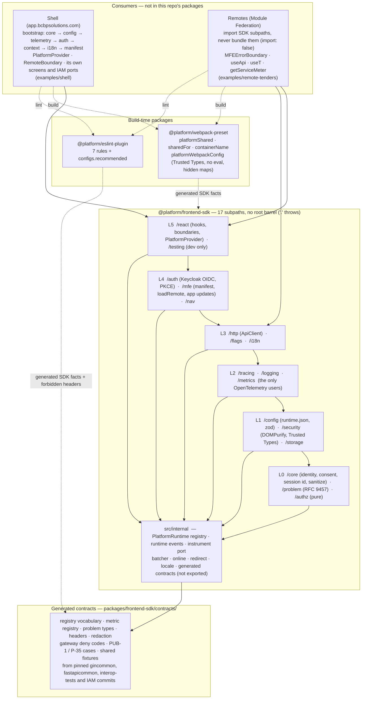

| Layer | Subpaths | Responsibility |
|---|---|---|
| 0 | `/core`, `/problem`, `/authz` | Page identity (registry vocabulary), consent, RUM session id, sanitizing; RFC 9457 model and parsing; the pure UI authorizer |
| 1 | `/config`, `/security`, `/storage` | `runtime.json` (zod, strict, frozen); DOMPurify + the `platform-sdk` Trusted Types policy; per-workspace storage that refuses token-like keys |
| 2 | `/tracing`, `/logging`, `/metrics` | OTLP/HTTP export to `/otel`, consent-gated, bounded queues; registry-checked Tier 2/3 meters |
| 3 | `/http`, `/flags`, `/i18n` | `ApiClient` (templates, correlation, retries, 401 refresh, problems); platform and tenant flags; ICU-lite messages, locale, `dir` |
| 4 | `/auth`, `/mfe`, `/nav` | Keycloak OIDC provider and workspace choice; remote manifest, `loadRemote`, app updates; safe navigation |
| 5 | `/react`, `/testing` | Hooks, `PlatformProvider`, `MFEErrorBoundary`, `RemoteBoundary`, global handlers; the test platform |

---

## Package dependency graph

Allowed imports between subpaths (an arrow means "may import"), and which subpaths may use the restricted third-party packages. **Generated** from `subpaths.json`, the same file that generates the exports map, the lint rules, dependency-cruiser's rules and the webpack preset's shared list.

> Source: [`docs/architecture/mermaid/package-dependencies.mmd`](docs/architecture/mermaid/package-dependencies.mmd)

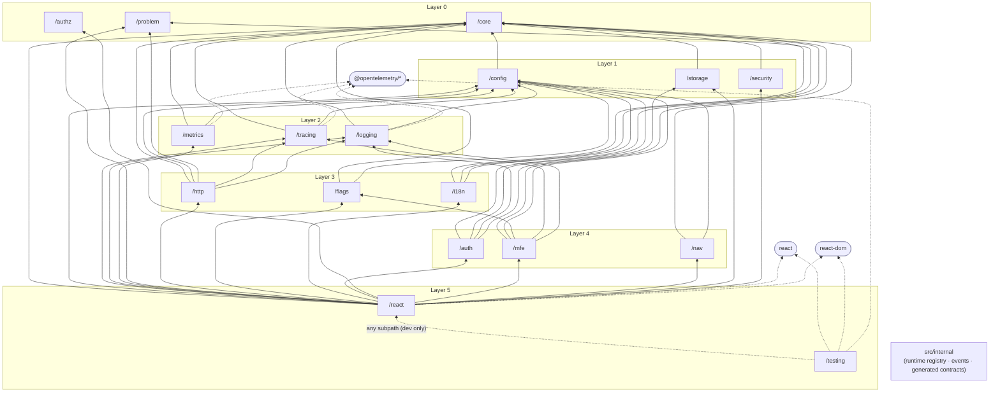

---

## Runtime registry

The `PlatformRuntime` lives on `globalThis[Symbol.for('@platform/frontend-sdk')]`, so every copy of the SDK on a page finds the same object. That's how a remote sees the shell's identity, consent, session, flags, permissions and token source, even though the remote never imports the shell. Change notification goes through the runtime too. `/i18n`, `/flags`, `/authz` and `/http` emit the topics `i18n`, `flags`, `authz` and `read-only`, and `/react` re-renders on them.

A second copy is a remote that bundled the SDK instead of taking it from the shell. It logs one error. If the major version matches, it binds to the existing runtime; otherwise it keeps its own.

> Source: [`docs/architecture/mermaid/runtime-registry.mmd`](docs/architecture/mermaid/runtime-registry.mmd)

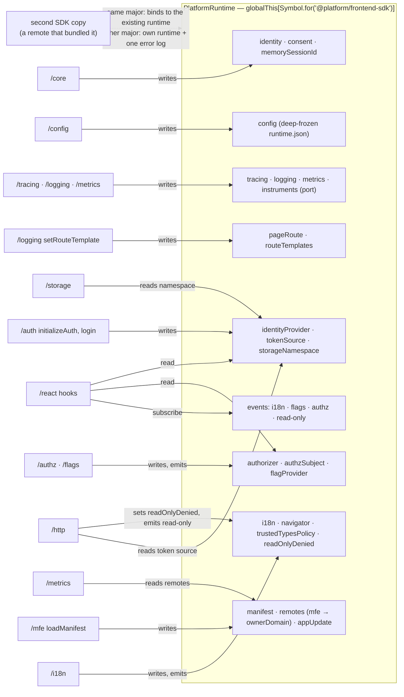

---

## Shell bootstrap

The shell (never a remote) runs the bootstrap once (design doc §C2). Steps 2–3 are fatal: they fall back to a static page, and no SDK telemetry is possible yet. Step 5 is never fatal. Step 7 is fatal only for routes that need auth. If step 9 fails, every remote slot shows its fallback. `examples/shell/src/bootstrap.tsx` is the §C4 code verbatim.

> Source: [`docs/architecture/mermaid/shell-bootstrap.mmd`](docs/architecture/mermaid/shell-bootstrap.mmd)

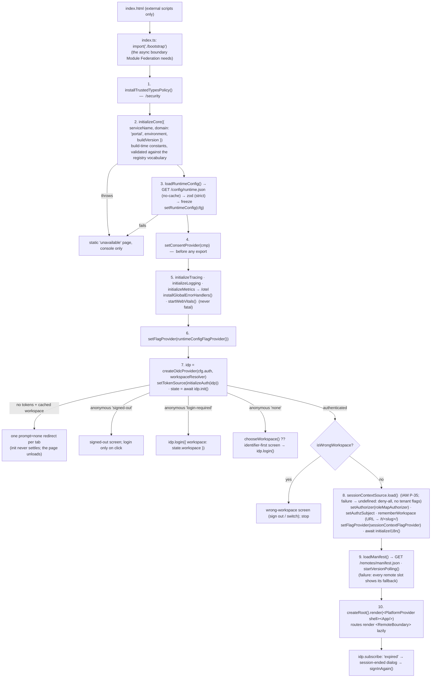

A remote run on its own skips all of this. Every API then returns a no-op or an anonymous default (`denyAll`, empty flags, the console logger), and remotes read the config only through `tryGetConfig()`.

---

## Request flow

`createApiClient({ mfe })` (or `useApiClient()`, bound to the nearest MFE scope) produces calls built from **route templates** (`'/tenders/:id'` + `params`), so the template is both the URL builder and the metric's `route` label. One logical call is one span and one metric observation, after retries.

> Source: [`docs/architecture/mermaid/request-flow.mmd`](docs/architecture/mermaid/request-flow.mmd)

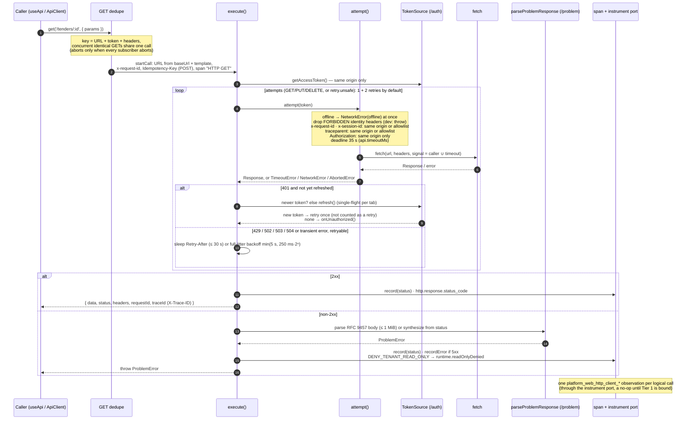

| Header | Sent to |
|---|---|
| `Authorization: Bearer` | the page's own origin only |
| `x-request-id`, `x-session-id`, `traceparent` / `tracestate` | the page's origin and the exact origins in `api.propagationAllowlist` / tracing's allowlist |
| `Idempotency-Key` | every `POST` (an automatic UUID unless given) |
| `x-user-id`, `x-tenant-id`, `x-tenant-roles`, `x-departments`, `x-plan`, `x-feature-flags`, `x-residency-mode` | **never**: dropped with a warn log, and a `TypeError` in local/dev |

---

## Authentication: login and callback

Keycloak runs on `auth.bcbpsolutions.com` (not proxied, design doc §D4), with one realm per paid tenant (`tenant-<slug>`) and the shared `trial` realm. Endpoints are built from Keycloak's fixed paths, with no discovery fetch. The realm comes only from a `Workspace` that `chooseWorkspace` checked against `paidRealmPrefix` or `trialRealm`.

> Source: [`docs/architecture/mermaid/auth-login-callback.mmd`](docs/architecture/mermaid/auth-login-callback.mmd)

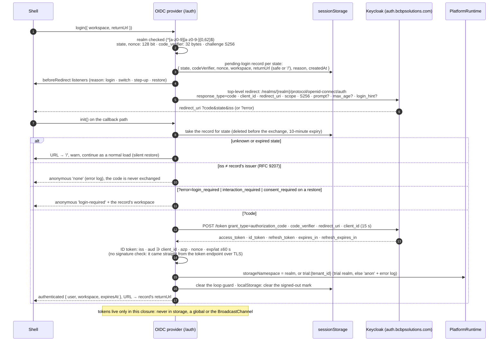

The callback always lands on the fixed `redirectPath`. `init()` replaces the URL with the record's `returnUrl` (it must pass `isSafeRedirect`, else `/`) before it resolves, so the shell never sees the callback path.

---

## Session lifecycle

Every full page load starts with no tokens: they live only in memory, and the cross-tab channel never carries one. So `init()` restores with one silent `prompt=none` round trip to the cached workspace. `tender-web` rotates refresh tokens with max reuse 0, and Keycloak tracks reuse per lineage (verified, design doc §D6 L). So every tab has its own lineage and **never sends a refresh token that has already been replaced**. Doing so would revoke the SSO session for every tab.

> Source: [`docs/architecture/mermaid/auth-refresh-restore.mmd`](docs/architecture/mermaid/auth-refresh-restore.mmd)

```mermaid
stateDiagram-v2
    [*] --> loading
    loading --> authenticated: callback exchanged
    loading --> anonymous: no session · signed-out mark · loop guard · rejected callback
    loading --> redirecting: no tokens + cached workspace<br/>(one prompt=none per tab, loop guard set)
    redirecting --> [*]: page unloads to Keycloak

    state authenticated {
        [*] --> idle_timer
        idle_timer --> refreshing: timer at exp − 60 s ± 10 s · getAccessToken near expiry · 401
        refreshing --> idle_timer: 200 → rotate tokens (never reuse a replaced refresh token)
        refreshing --> waiting_online: offline before sending → keep the token
        waiting_online --> refreshing: online event
    }

    authenticated --> expired_server: invalid_grant before refresh_expires_in<br/>(serverEnded: true, e.g. trial → paid)
    authenticated --> expired_natural: invalid_grant / refresh token past its expiry<br/>(serverEnded: false)
    authenticated --> expired_idle: no activity in any tab for idleTimeoutMs<br/>(idle: true; session id rotated)
    authenticated --> restoring: sent but outcome unknown (timeout, network after send,<br/>non-invalid_grant error, bad ID token) → drop the lineage
    restoring --> [*]: wait online → beforeRedirect('restore') → prompt=none redirect
    authenticated --> anonymous: logout (this tab or a 'logout' broadcast)
    authenticated --> expired_natural: 'workspace-switched' broadcast from another tab

    expired_server --> [*]: shell dialog → signInAgain(forceResolve: true)
    expired_natural --> [*]: shell dialog → signInAgain()
    expired_idle --> [*]: shell dialog → signInAgain(prompt=login)
```

| Mark | Storage | Set | Cleared |
|---|---|---|---|
| Pending-login record (per `state`) | sessionStorage | before every authorize redirect | at the callback (before the exchange); expired after 10 min |
| Loop guard (one `prompt=none` per tab) | sessionStorage | before a silent redirect | when `init()` ends `authenticated` |
| Signed-out mark | localStorage (all tabs) | `logout()` | the next successful callback |
| Last activity (idle timeout) | localStorage (all tabs) | activity events, debounced to 5 s | — |
| Workspace cache (slug → realm, trial) | localStorage | `chooseWorkspace` (resolved slug) · `rememberWorkspace` | never by `clearAllAppStorage` |

---

## Remote loading

The shell loads `/remotes/manifest.json` once. Routes render `<RemoteBoundary remote module>`, which lazily calls `loadRemote` inside `Suspense` and an `MFEErrorBoundary`. Container globals follow one rule shared by `loadRemote` and `@platform/webpack-preset`'s `containerName`: the remote's name, with `-` replaced by `_`.

> Source: [`docs/architecture/mermaid/remote-loading.mmd`](docs/architecture/mermaid/remote-loading.mmd)

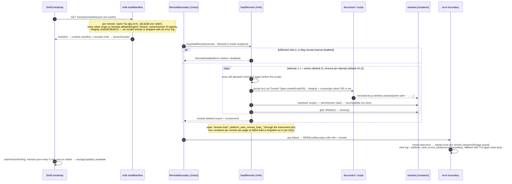

Sharing: the shell provides React, react-dom, `@opentelemetry/api` (`~1.10.0`) and every SDK subpath except `/testing` as strict singletons (`platformShared`). Remotes take the SDK with `import: false`, so they never bundle it. A remote built against an incompatible SDK major fails share negotiation, which shows as a `RemoteLoadError` in its own boundary, not as a broken shell.

---

## Error handling (RFC 9457)

Every non-2xx answer becomes a `ProblemError`. Platform services send `application/problem+json`; anything else is synthesized from the status, and its body is never surfaced. The SDK matches types by `typeId` (`{domain}/{error}`), never by the full URI, title or detail. See [docs/problem-details](docs/problem-details/README.md).

> Source: [`docs/architecture/mermaid/error-handling.mmd`](docs/architecture/mermaid/error-handling.mmd)

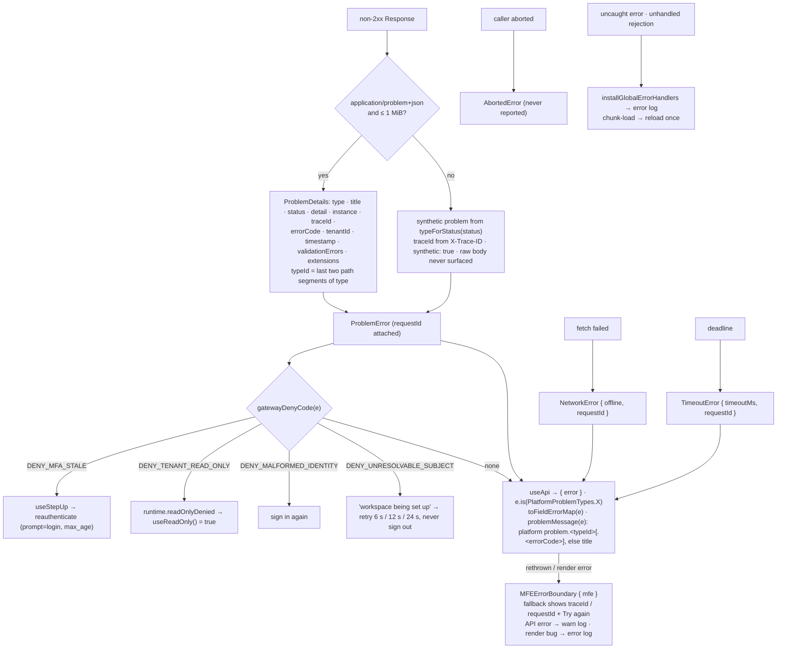

---

## Telemetry pipeline

Logs, traces and metrics leave the page over OTLP/HTTP to the same-origin `/otel` path. CloudFront forwards it to the OTel Collector; there is no Faro SDK and no second pipeline. Everything is redacted with the same rules as gincommon's log sanitizer, gated on consent, and queued with fixed bounds, so a slow or unreachable collector costs a fixed amount of memory. See [docs/observability](docs/observability/README.md).

> Source: [`docs/architecture/mermaid/telemetry-pipeline.mmd`](docs/architecture/mermaid/telemetry-pipeline.mmd)

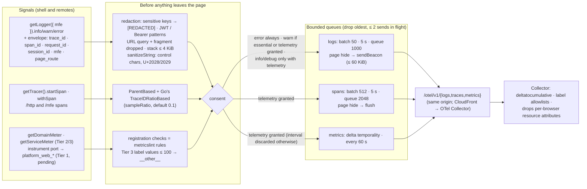

Identity on every signal is the **page** identity (`initializeCore`: `domain` / `service` / `environment`, e.g. `portal` / `web-app`). Remotes are told apart by the `mfe` attribute or label, never by a second `domain`. The one exception is a remote's own Tier 2/3 metrics, which carry its manifest `ownerDomain` (design doc §D1).

---

## Contracts and drift control

Nothing backend-shaped is written by hand. Constants, vocabularies, rules and fixtures are generated from backend commits pinned in `contracts/sources.json`, and CI fails when they drift. Moving a pin is a reviewed change: `pnpm contracts:sync --update-pins`, then review the generated diff.

> Source: [`docs/architecture/mermaid/contracts-drift.mmd`](docs/architecture/mermaid/contracts-drift.mmd)

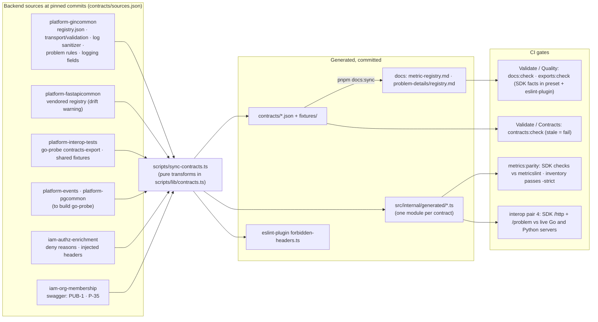

---

## CI and release

`.github/` mirrors platform-gincommon's pipeline: the same job names and gates. gincommon's image jobs (build, Trivy, smoke) map to this repo's three npm packages: pack them, scan the files and lockfile, smoke-test the tarballs.

> Source: [`docs/architecture/mermaid/ci-pipeline.mmd`](docs/architecture/mermaid/ci-pipeline.mmd)

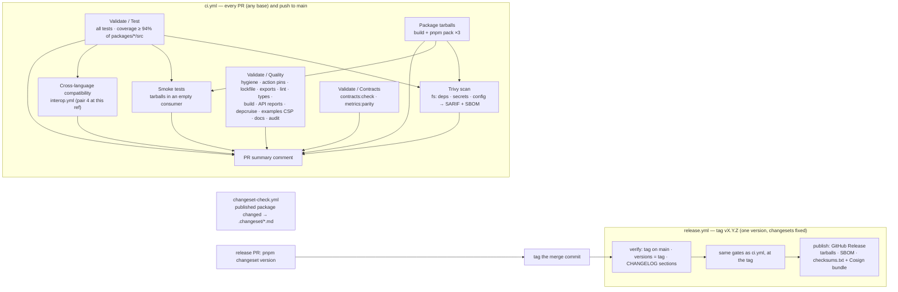

---

## Concurrency model

The browser is single-threaded; concurrency here means overlapping promises and several tabs.

| Concern | Mechanism |
|---|---|
| Concurrent identical GETs | One in-flight call per key (URL + token + headers); the shared fetch is aborted only when every subscriber has aborted |
| Token refresh | One in-flight `refresh()` per tab; the timer, `/http`'s 401 path and direct callers await the same promise; a new refresh starts only after it settles, with the token it returned |
| Tabs | One refresh lineage per tab, never shared; `BroadcastChannel('platform-auth')` carries only `logout` and `workspace-switched`; idle activity and the signed-out mark are shared through localStorage |
| Remote containers | One container per remote per page; concurrent `loadRemote` calls share it; a failed load is forgotten so a retry starts fresh |
| i18n catalogs | One in-flight load per namespace and locale |
| Telemetry export | At most two sends in flight per signal; beyond the queue bound the oldest items are dropped and counted |
| Runtime listeners | Snapshot before notify; a throwing listener never stops the others |

## Failure domains

| Failure | Effect | What still works |
|---|---|---|
| `runtime.json` unreachable or invalid | Fatal at bootstrap (static page) | — |
| `/otel` down or slow | Queues fill, oldest dropped, failures counted | Everything else; no retries into a struggling page |
| Keycloak unreachable during refresh | Ambiguous outcome → lineage dropped → silent restore after `online` | Calls fail with 401/`NetworkError` meanwhile; no sign-out |
| Session ended by the server (`invalid_grant`) | `expired { serverEnded: true }` → dialog → re-resolve the workspace | Drafts saved by `beforeRedirect` listeners |
| P-35 session context fails | Deny-all permissions, platform flags only, workspace not cached | Signed-in shell |
| Manifest fails | Every remote slot shows its fallback | Shell routes |
| A remote fails to load or render | That remote's boundary fallback with `traceId` / Try again | Shell and other remotes |
| Old chunks gone after a deploy | One reload per version (sessionStorage guard) | — |
| Consent not granted | Only `error` logs and essential `warn` logs leave the page | All functionality |
| localStorage / sessionStorage blocked | Session id per page; storage kept in memory; **sign-in impossible** (no pending-login record), stated, never silent | Anonymous pages |

## Key invariants

| Invariant | Where enforced |
|---|---|
| Tokens are never in storage, a global, a log or the channel | `/auth` closure; `/storage` refuses token-like keys; redaction of JWT/Bearer patterns; auth tests scan storage |
| The browser never sends identity headers | `/http` drops `FORBIDDEN_REQUEST_HEADERS` (generated from gincommon + AuthZ Enrichment); `@platform/eslint-plugin` `no-identity-headers`; interop pair 4 |
| The access token goes to the page's own origin only | `/http` `isSameOrigin` check before `Authorization` |
| A replaced refresh token is never sent | single-flight `refresh()`; ambiguous failures drop the lineage instead of retrying |
| Metric `route` labels are templates, never raw URLs | `ApiClient` takes templates; `api-route-template` lint rule |
| Metric names, labels and units follow the registry | `/metrics` registration checks = gincommon `metricslint` rules (`metrics:parity` in CI) |
| One page identity; remotes never set `domain` | `/core` `initializeCore` once; `IdentityMismatchError` on a different second call |
| Nothing leaves the page without consent (except errors) | consent gates in the log, span and metric pipelines |
| No `eval`, no inline script (CSP `script-src 'self'`) | preset (no eval devtools, `environment.globalThis`); Zod jitless; `examples:check`; `no-eval` lint |
| Untrusted HTML only through DOMPurify + Trusted Types | `/security` `sanitizeHtml`; `no-unsafe-html` lint |
| A remote never bundles the SDK | `sharedFor('remote')` `import: false`; `examples:check` |
| Contracts are generated, never edited | `contracts:check`, `docs:check` in CI |

## Release and distribution

All three packages share one version (`fixed`). The release flow:
1. A release PR runs `pnpm changeset version`.
2. The merge commit is tagged `vX.Y.Z`.
3. `release.yml` verifies the tag and versions, reruns every gate at the tag, and publishes a **GitHub Release** with the tarballs, a CycloneDX SBOM and Cosign-signed checksums. There's no npm registry yet.

During the alpha, versions are `1.0.0-alpha.N` and remotes share the SDK under `^1.0.0-0`. `1.0.0` is cut with the first environment, and SemVer is strict from then on (design doc §C3 "Versioning").

## Testing strategy

| Layer | How |
|---|---|
| Unit | Vitest per subpath (`packages/frontend-sdk/test/<subpath>`). Node by default; `happy-dom` for React; `jsdom` for DOMPurify. Coverage gate ≥ 94 % statements of `packages/*/src` |
| Contract | Shared fixtures from platform-interop-tests (headers, identity, redaction, problem bodies) and the PUB-1 / P-35 cases, run by the SDK and by the example shell's ports |
| Fake backends | A Keycloak fake at the HTTP level (PKCE, rotation, reuse revokes the session); `mockApi` / `mockProblem` |
| Parity | `metrics:parity`: SDK registration checks vs gincommon `metricslint`, inventory passes `-strict` |
| Cross-language | interop-tests pair 4: the SDK's `/http` + `/problem` against the live Go and Python servers |
| Build output | `examples:check` (CSP, container global, no SDK in remotes); real webpack builds in the preset's tests |
| Package | Smoke tests of the packed tarballs in an empty consumer project |

## Consumer conformance checklist

A shell or remote conforms when:

- It imports SDK subpaths only (`@platform/eslint-plugin` `configs.recommended` passes).
- It builds with `platformWebpackConfig({ role, name, exposes })` and adds no other shared config for React, OTel or the SDK.
- **Shell:**
  - it runs the bootstrap in order, implements `WorkspaceResolver` and `SessionContextSource` as ports, and passes the PUB-1/P-35 contract cases;
  - it shows its own signed-out, session-ended and wrong-workspace screens, and never signs in automatically after a logout.
- **Remote:**
  - it wraps its root in `MFEErrorBoundary` (or is loaded through `RemoteBoundary`);
  - it uses `useApi` / `useApiClient` with route templates;
  - it registers its page templates (`useRouteTemplate`) and keeps drafts in `storage(appId, { area: 'session' })` from `useBeforeAuthRedirect`.
- Its own metrics use `getServiceMeter()` (Tier 3), and its CI runs `metricslint check` on `renderMetricInventory()`.
- It serves the CloudFront response headers of `examples/cloudfront` (CSP with the three Trusted Types policies).

## Threat model

| Threat | Mitigation |
|---|---|
| XSS steals tokens | Tokens only in a closure (never storage); strict CSP (`script-src 'self'`, `require-trusted-types-for 'script'`); DOMPurify for any HTML |
| A forged identity header from the browser | Never sent by the SDK, lint-checked, and stripped by Envoy regardless |
| An authorization code reused or injected | PKCE S256; one-time pending record per `state`; RFC 9207 `iss` check; ID-token `nonce`/`aud`/`azp`/`iss`/time checks |
| A code from one realm exchanged at another | The `iss` check against the record's realm before any exchange |
| An open redirect after login | `returnUrl` must pass `isSafeRedirect` (same origin; no protocol-relative, backslash or control-character tricks) |
| Tenant data seen by another tenant on a shared browser | `/storage` namespaced by realm or `trial:<tenant_id>`; `clearAllAppStorage` on logout and switch; `anon` writes are no-ops |
| A malicious remote entry | Manifest entries limited to same origin or exact allowed origins, checked again before the script; SRI when given; kill switch |
| Telemetry leaking secrets or PII | Redaction (sensitive keys, JWT/Bearer, URL query), bounded stack size, consent; the Collector drops per-browser attributes |
| A reload loop after a bad deploy or failed restore | Reload once per version; one `prompt=none` per tab |

## Developer tools

| Command | Purpose |
|---|---|
| `pnpm verify` | Everything CI's quality and test gates run, locally |
| `pnpm contracts:sync` / `contracts:check` | Regenerate / check `contracts/` from the pinned sources |
| `pnpm docs:sync` / `docs:check` | Regenerate / check the generated docs and the diagram blocks here |
| `pnpm api` / `api:check` | api-extractor reports per subpath |
| `pnpm exports:sync` | Exports map and the SDK facts in the tooling packages |
| `pnpm metrics:parity` | SDK checks vs gincommon `metricslint` |
| `pnpm examples:check` | CSP and sharing checks of the example builds |
| `pnpm changeset` | Record a change to a published package |

## Documentation assets

Architecture diagrams live as standalone Mermaid files under `docs/architecture/mermaid/` and are embedded into this document verbatim, each under a `> Source:` link back to its `.mmd` file, so a diagram only has to be correct in one place. `pnpm docs:sync` writes the blocks; `pnpm docs:check` fails CI when they drift.

> Source: [`docs/architecture/mermaid/documentation-assets.mmd`](docs/architecture/mermaid/documentation-assets.mmd)

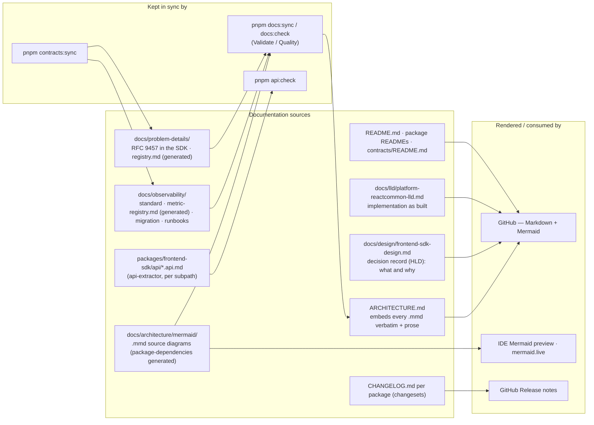

| Document | Description |
|---|---|
| [README.md](README.md) | Workspace layout, commands, CI and releases |
| [`docs/design/frontend-sdk-design.md`](docs/design/frontend-sdk-design.md) | The design and its decisions (HLD): public API per subpath, contracts, backend changes it relies on |
| [`docs/lld/platform-reactcommon-lld.md`](docs/lld/platform-reactcommon-lld.md) | Low-level design: the implementation as built, limits, algorithms, state, failure handling |
| [`docs/architecture/README.md`](docs/architecture/README.md) | Index of the `.mmd` diagrams embedded above |
| [`docs/observability/README.md`](docs/observability/README.md) | The observability standard as the SDK implements it |
| [`docs/observability/metric-registry.md`](docs/observability/metric-registry.md) | Generated: the registry the SDK validates against |
| [`docs/observability/migration.md`](docs/observability/migration.md) | Moving an existing app onto the SDK |
| [`docs/observability/runbooks.md`](docs/observability/runbooks.md) | Runbooks for frontend symptoms and the proposed web alerts |
| [`docs/problem-details/README.md`](docs/problem-details/README.md) | RFC 9457 in the browser |
| [`docs/problem-details/registry.md`](docs/problem-details/registry.md) | Generated: platform problem types and gateway deny codes |
| [`packages/frontend-sdk/api/`](packages/frontend-sdk/api/) | Public API per subpath (api-extractor) |
| [`packages/frontend-sdk/contracts/README.md`](packages/frontend-sdk/contracts/README.md) | What each generated contract is and where it comes from |
| [`examples/cloudfront/README.md`](examples/cloudfront/README.md) | CloudFront behaviors, deploy order, CSP |

Render a diagram locally in a Mermaid-aware IDE (VS Code + Mermaid Preview, IntelliJ + Mermaid plugin), or paste it into [mermaid.live](https://mermaid.live).
