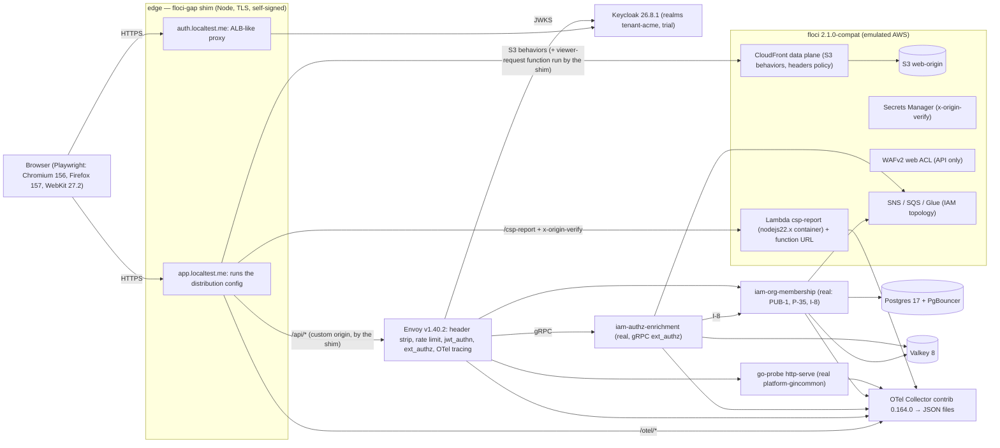

# Integrated deployment run: Keycloak, the gateway and CloudFront

An end-to-end run of the **real example shell** (`examples/shell` + `examples/remote-tenders`) in Chromium,
Firefox and WebKit against a production-like stack: Keycloak 26, Envoy with the real IAM services, the web
distribution on an AWS emulator, and an OpenTelemetry Collector. This report lists the problems that showed up
only once these parts ran together. Unit, integration, smoke and the single-origin browser suites
(`test/browser`) did not find any of them.

- Stack: `docker-compose.yml` (compose project `reactcommon-e2e`)
- Suite: `test/stack/e2e.spec.ts`, config `test/stack/playwright.config.ts`
- Run date: 2026-10-31. Repository: `test/layout` at `5c9645e` (plus this change).

## 1. Environment



| Component | Real, emulated or shim | Version / source |
|---|---|---|
| Example shell and tenders remote | **Real**, built for `PLATFORM_ENVIRONMENT=staging` (`__ENVIRONMENT__` is a build-time define) | this repo |
| `/config/runtime.json` | Real file, this environment's values (`idpOrigin https://auth.localtest.me`, `sampleRatio 1`) | `scripts/prepare.mjs` |
| Keycloak | **Real** | `quay.io/keycloak/keycloak:26.8.1`, `start`, `KC_HOSTNAME=https://auth.localtest.me`, `KC_PROXY_HEADERS=xforwarded` |
| Realms `tenant-acme`, `trial` | Built from IAM `realm-template.json` plus what `iam-realm-provisioner` adds (tender-web redirect, web origin and post-logout URIs, the `tenant_id` mapper and admin-only user-profile attribute on `trial`) | `iam-realm-provisioner@6ed5bb9` |
| Envoy | **Real**. The config is written for this run from IAM HLD v1.58 §4.3, §8.2.7, §8.3, §11.1 and the `iam-authz-enrichment` README sketch. No checked-in gateway config exists. | `envoyproxy/envoy:v1.40.2`, `docker/envoy/envoy.template.yaml` |
| iam-authz-enrichment | **Real**, built from its Dockerfile (GitHub token passed as a BuildKit secret) | `4bea2ea` |
| iam-org-membership | **Real**: PUB-1, P-35, I-8 with Postgres + PgBouncer + Valkey + floci. Seeded by `docker/org-membership/seed.sql` | `3d17d87` |
| "Tenders" API | **Real gincommon**: platform-interop-tests `go-probe http-serve`. Envoy maps `/api/tenders/{id}` to its `/errors/tenders/{id}` (404 `TENDER_NOT_FOUND` problem+json) and `/api/v1/probe/*` to `/whoami`, `/echo` | `platform-interop-tests@93e3481`, `platform-gincommon@98957b8` (v2) |
| S3, CloudFront (API + S3 data plane), Lambda, Secrets Manager, WAFv2 API, SNS/SQS/Glue | **Emulated**: floci | `floci/floci:2.1.0-compat` |
| CloudFront Functions execution, custom origins | **Shim** (`docker/edge/server.mjs`). See §6. | node:22-alpine |
| OTel Collector | **Real**, with file exporters (`.state/otel/*.jsonl`) | `otel/opentelemetry-collector-contrib:0.164.0` |
| Valkey, Postgres, PgBouncer | Real | `valkey/valkey:8-alpine`, `postgres:17-alpine`, `edoburu/pgbouncer:latest` |
| Not deployed | iam-catalog-admin, iam-tender-acl, iam-realm-provisioner (its realm output is reproduced statically), user profile, audit log, Billing | — |

### Host ports

| Port | What |
|---|---|
| `443` (`STACK_HTTPS_PORT`, all interfaces) | the viewer entry: `https://app.localtest.me`, `https://auth.localtest.me` (both resolve to 127.0.0.1 in public DNS) |
| `127.0.0.1:18080` | Keycloak, direct (the tests use the admin API) |
| `127.0.0.1:18566` | floci |
| `127.0.0.1:19901` | Envoy admin |

Nothing else is published. The stack avoids 4566/4567, 5432–5534, 6379/6380, 8080 and 9090.

### Test identities

| User | Realm | Org & Membership |
|---|---|---|
| alice | tenant-acme | active, `tenant_admin`, department reviewer |
| bob | tenant-acme | active, member (the second person on a shared device) |
| carol | trial (`tenant_id` claim = globex) | active, `tenant_owner` of trial tenant `globex` |
| dave | tenant-acme | **no membership** (ext_authz deny) |

The `tenant-acme` access tokens last 60 s, so the refresh lineage is exercised in a test.

## 2. How to run

```sh
pnpm install && pnpm build          # the SDK dist is bundled into the Lambda and the shell
pnpm run test-browser-install       # once
gh auth login                        # stack-up reads `gh auth token` for the IAM images' private Go modules
pnpm run stack-up                    # renders .state, builds images, starts, deploys, waits
pnpm run test-stack                  # chromium, firefox, webkit, then the `gateway` project
pnpm run stack-down                  # containers, network, volumes and floci's Lambda containers; --purge also removes images and .state
```

- `stack-up` needs Docker Desktop and permission to bind port 443. On a busy host, use `STACK_HTTPS_PORT=8443 pnpm run stack-up`; every origin then includes the port.
- The token stays in the environment of the `docker compose build` process. It is never written to a file or printed.
- Toggles to reproduce issues (scripts/prepare.mjs + `stack-constants.ts`):
  - `STACK_AUDIENCE_MAPPER=false`: Issue 13.
  - `STACK_PACK_TRACE_REASON=true`: Issue 14.
  - `DEPLOY_SET_CACHE_CONTROL=false`: Issue 15, the deploy as the README literally says.
  - `STACK_ACME_TOKEN_LIFESPAN`, `AUTHZ_ORG_MEMBERSHIP_TIMEOUT`.
- Evidence the tests read: `.state/otel/{traces,logs}.jsonl` (Collector), `.state/logs/edge.jsonl` (shim) and `docker logs reactcommon-e2e-envoy-1` (JSON access log with the upstream identity headers).

## 3. Test matrix and results

How to read the result marks:

- ✅ passes.
- ⚠️ `test.fail` on a documented issue (the test fails as expected).
- ⏭ skipped.

The emulator rows `E-n` are in §6.

| # | Test | Chromium | Firefox | WebKit |
|---|---|---|---|---|
| 1 | Anonymous → PUB-1 (Envoy bypass → org-membership) → Keycloak login form, PKCE S256 → callback → `/t/acme/`. P-35 with JWT, enriched by AuthZ Enrichment. Envoy log shows the upstream `x-tenant-id`/`x-user-id` | ✅ | ✅ | ✅ |
| 2 | Forged `x-tenant-id` … `x-residency-mode` never reach an upstream: gincommon `/whoami` sees acme/alice. `/echo` shows exactly the 7 enriched headers and no `Authorization`. The bypass route shows none | ✅ | ✅ | ✅ |
| 3 | Deep-link reload: `index.html` via spa-rewrite (`no-cache`), silent `prompt=none` restore, `/assets/*` immutable JS, manifest `no-cache`, `remoteEntry.js` immutable with `sha384` integrity, **remote renders** | ⚠️ Issue 1 | ⚠️ Issue 1 | ✅* |
| 4 | Remote with the Issue 1 fix (TT `'allow-duplicates'`, applied through a shim test hook) → problem+json shown, ids and logs correlated | ⚠️ Issue 2 | ⚠️ Issue 2 | ⚠️ Issue 2 |
| 5 | `/auth/callback` served by the rewrite, scripts from `/assets` | ✅ | ✅ | ✅ |
| 6 | P-35 trace id continues through Envoy, ext_authz (authz-enrichment) and org-membership spans | ✅ | ✅ | ✅ |
| 7 | Gateway 401 shape (jwt_authn) as the SDK parses it | ⚠️ Issue 3 | ⚠️ Issue 3 | ⚠️ Issue 3 |
| 8 | ext_authz deny (dave) → 403 problem+json, `gatewayDenyCode` = `DENY_UNRESOLVABLE_SUBJECT` | ✅ | ✅ | ✅ |
| 9 | gincommon problem through Envoy keeps `traceId` and `x-request-id` | ✅ | ✅ | ✅ |
| 10 | Cold AuthZ cache: first request within the ext_authz budget | ✅/⚠️ Issue 12 (timing) | ✅ | ✅ |
| 11 | Refresh lineage in one tab: rotation, no reuse error | ✅ | ✅ | ✅ |
| 12 | Refresh cadence with a 60 s token | ⚠️ Issue 4 | ⚠️ Issue 4 | ⚠️ Issue 4 |
| 13 | Two tabs, two refresh lineages in one Keycloak session (`revokeRefreshToken=true`) | ✅ | ✅ | ✅ |
| 14 | Example offers a sign-out control | ⚠️ Issue 6 | ⚠️ Issue 6 | ⚠️ Issue 6 |
| 15 | Global logout: end-session with the SDK's exact parameters → back to `/`, "You are signed out", SSO gone | ✅ | ✅ | ✅ |
| 16 | Shared device: after sign-out, `prompt=login`; bob signs in; P-35 is bob's | ⚠️ Issue 10 | ⚠️ Issue 10 | ⚠️ Issue 10 |
| 17 | Cross-tab sign-out reaches the open tab | ⚠️ Issue 7 | ⚠️ Issue 7 | ⚠️ Issue 7 |
| 18 | Real CSP violation → `/csp-report` → Lambda → Collector | ⚠️ E-6 | ⚠️ Issue 11 | ⚠️ Issue 11 |
| 19 | With the Issue 11 fix: `x-origin-verify` enforced (403 without it), both report formats → `csp.violation` OTLP logs without query strings | ✅ | ✅ | ✅ |
| 20 | Browser clock 3 min fast, 60 s token | ⚠️ Issue 8 | ⚠️ Issue 8 | ⏭ (Playwright clock hangs WebKit teardown) |
| 21 | `@gateway` PUB-1 per-IP rate limit: 429 after 20 requests. A viewer-sent `X-Forwarded-For` does not reset the bucket. The bucket refills | ✅ (gateway project, Chromium) | | |
| 22 | `@gateway` WAF ACL associated, and its rate rule blocks a flood | ⚠️ E-3/E-4 | | |
| 23 | `@gateway` Keycloak key rotation vs Envoy JWKS cache | ⚠️ Issue 9 | | |

All three engines enforce Trusted Types (Chromium 156, Firefox 157, WebKit 27.2), so Issue 1 shows in each.

**Two full runs** (`pnpm run test-stack`, all four projects, serial): see §7 for the numbers.

## 4. Issues that only appear in the integrated deployment

Severity scale:

- **Critical**: a feature is broken in production.
- **High**: broken for a common path, or a security weakness.
- **Medium**: degraded behaviour or a likely incident.
- **Low**: polish or hardening.

### Issue 1 — A remote cannot load under the production CSP: duplicate Trusted Types policy `platform-webpack`

- **Symptom:** Every `RemoteBoundary` shows "Something went wrong."
- **Evidence:** Chromium console:
  > Creating a TrustedTypePolicy named 'platform-webpack' violates the following Content Security Policy directive because a TrustedTypePolicy with that name already exists and the directive does not contain 'allow-duplicates': "trusted-types platform-sdk platform-webpack dompurify".

  `securitypolicyviolation` reports `trusted-types / trusted-types-policy`. The Collector receives `remote failed to load`, `reason=incompatible`, "module ./EditTender is not exposed or failed to load". Firefox 157 shows the same.
- **Root cause:** The webpack preset gives the shell and every remote the same `output.trustedTypes.policyName: 'platform-webpack'`. The remote's runtime calls `trustedTypes.createPolicy('platform-webpack')` a second time in the same page. `csp.mjs` lists the name once and has no `'allow-duplicates'`. The `test/browser` CSP suite boots only the shell, so it never loads a second webpack runtime.
- **Owner:** SDK (`@platform/webpack-preset`) + CloudFront config (`examples/cloudfront/csp.mjs`).
- **Severity:** Critical: no micro-frontend works in production.
- **Suggested fix:** Give remotes their own policy name, e.g. `platform-webpack-<remote>`, and generate the CSP `trusted-types` list from the manifest. Or add `'allow-duplicates'` to the CSP (simplest; the suite's fix variant shows it gets past this step). Add a real-browser test that loads one remote under `securitypolicy()`.

### Issue 2 — The shell's share scope does not provide the SDK subpaths it never imports

- **Symptom:** With Issue 1 fixed, the remote still fails: "module ./EditTender failed to evaluate".
- **Evidence:** The factory throws:
  > Shared module @platform/frontend-sdk/problem doesn't exist in shared scope default

  The built shell's federation metadata lists only `auth, authz, config, core, flags, http, logging, metrics, mfe, react, security, tracing` (and i18n). There is no `problem`, `storage`, `nav` or root.
- **Root cause:** Webpack provides a shared module only if the host bundle actually references it. `sharedFor('shell')` declares every subpath, but the example shell never imports `/problem`. The remote gets the SDK with `import: false`, so it has no fallback. `test/e2e/shell.test.tsx` mocks federation, so it cannot see this.
- **Owner:** SDK (webpack preset) / example shell.
- **Severity:** Critical: any remote that uses an SDK subpath the shell does not happen to use breaks at runtime, in production only.
- **Suggested fix:** Have the preset add a generated "provide all SDK subpaths" module to the shell entry (`import('@platform/frontend-sdk/<each>')` in a never-executed branch, or `eager` provides). Have `pnpm examples:check` assert the shell's provided set ⊇ `SDK_SUBPATHS`.

Issue 18 makes this hard to diagnose: the logged error has no `cause`.

### Issue 3 — The gateway's own error replies are not problem+json, and the 401 leaks the internal origin

- **Symptom:** A missing or invalid token returns `401 text/plain "Jwt is missing"` with:

  ```
  WWW-Authenticate: Bearer realm="https://envoy:10000/api/v1/me/session-context"
  ```

  A bad `aud` returns `403 text/plain ""` (Issue 13). The PUB-1 rate limit returns `429 text/plain "local_rate_limited"`.
- **Evidence:** curl through the edge, and test 7.
- **Root cause:** jwt_authn and local_ratelimit send local replies. Only ext_authz denials carry AuthZ Enrichment's problem body. The `realm` is built from the Host Envoy saw. CloudFront's `AllViewerExceptHostHeader` sends the origin domain as Host, so the internal name appears.
- **SDK effect:**
  - `parseProblemResponse` falls back to a status-derived problem with no `traceId` or `code`, so the error boundary has no reference.
  - The identifier screen shows "We could not find that workspace" for a rate limit.
- **Owner:** Gateway config.
- **Severity:** Medium (Low for the info leak alone).
- **Suggested fix:** Add `local_reply_config` mappers that render `application/problem+json` (`platform/unauthorized`, `platform/forbidden`, `platform/too-many-requests`) with `x-request-id`. Set the jwt_authn `WWW-Authenticate` realm explicitly, or strip it.

### Issue 4 — Refresh storm when the access token lives ≤ 60 s

- **Symptom:** 9–29 (Chromium), 15 (Firefox) and 11–23 (WebKit) `refresh_token` grants in 45 s with a 60 s token.
- **Root cause:** `oidc.ts` schedules the refresh at `expiresAt − REFRESH_LEAD_MS (60 s) ± 10 s`. When `expires_in ≤ 60`, every refresh is due at once. Keycloak's template uses 300 s, but realm admins can shorten it, and the provisioner does not pin it.
- **Owner:** SDK.
- **Severity:** Medium: load on Keycloak, and a burst on every tab.
- **Suggested fix:** Use a lead of `min(60 s, expires_in / 3)`, plus a minimum interval between refreshes.

### Issue 5 — (not reproduced) refresh reuse across tabs

With `revokeRefreshToken=true` and `refreshTokenMaxReuse=0`, two tabs sharing one Keycloak session each kept their own rotating lineage. Keycloak 26.8 tracks reuse per lineage. No action is needed. The test stays as a regression guard.

### Issue 6 — The example shell has no way to sign out

- **Symptom:** No control calls `IdentityProvider.logout()` (local or `{ global: true }`). Only the trial wrong-workspace dialog has a sign-out button.
- **Owner:** Example.
- **Severity:** Medium: the reference integration cannot exercise logout, and the shared-device flow (§C1) is unreachable.
- **Suggested fix:** Add a header menu with "Sign out" and "Sign out everywhere". Its `logout()` call is what the suite emulates (it sets the signed-out mark, or navigates to end-session with the SDK's parameters).

### Issue 7 — A sign-out in another tab leaves this tab rendering the app

- **Symptom:** The SDK moves the tab to `anonymous` / `signed-out` (BroadcastChannel). The example subscribes only to `expired`, so the workspace stays on screen with no token. Its next API call is a 401 text/plain (Issue 3).
- **Owner:** Example (or the SDK's `PlatformProvider`).
- **Severity:** Medium (shared device).
- **Suggested fix:** In `bootstrap.tsx`, on `anonymous` with reason `signed-out`, unmount the app and `showSignedOut`.

### Issue 8 — A client clock a few minutes fast makes sign-in fail silently with short tokens

- **Symptom:** With the browser clock +3 min and a 60 s token, the code exchange succeeds, but the ID token is rejected (`exp + 60 s skew < now`). The user lands back on the identifier screen, with no message (`url=/`, screen "Sign in … Continue"). There was no redirect loop.
- **Root cause:** `idTokenProblem` compares `exp` and `iat` with the local clock, allowing 60 s. Real laptops drift. The window equals the token lifetime plus 60 s.
- **Owner:** SDK.
- **Severity:** Medium.
- **Suggested fix:**
  - Judge `exp` relative to the server: e.g. trust `expires_in` and accept `exp` within `iat + lifetime`, or estimate skew from the token endpoint's `Date` header.
  - Show a "check your device clock" message when `iat` / `exp` fail.

### Issue 9 — Keycloak key rotation: new tokens fail at Envoy until the JWKS cache expires

- **Symptom:** After adding a higher-priority RS256 key, P-35 with a fresh token returns `401` ("Jwt verification fails").
- **Evidence:** Test 23 (`kid` FOsetg…).
- **Root cause:** The jwt_authn `remote_jwks.cache_duration` (300 s here; default 600 s) does not refetch on an unknown `kid`. Keycloak signs with the new active key immediately.
- **Owner:** Gateway config + Keycloak operations.
- **Severity:** High: an outage of up to `cache_duration` on every rotation, per realm.
- **Suggested fix:**
  - Rotate in two phases in Keycloak: add the new key *passive* (published in the JWKS), wait more than `cache_duration`, then make it active.
  - Document this in the realm runbook.
  - Optionally shorten `cache_duration` with `async_fetch`.

The same thing happened when the Keycloak container was recreated (new keys) during this work.

### Issue 10 — Shared device: after a local sign-out, `prompt=login` shows the previous user

- **Symptom:** The next "Sign in" carries `prompt=login`. Keycloak, with alice's SSO session still alive, shows "Please re-authenticate to continue" with **alice's username** (`#kc-attempted-username`) and only a password field. Bob must find "Restart login" (`#reset-login`).
- **Root cause:** A local logout leaves the Keycloak SSO session alive by design. `prompt=login` re-authenticates the *same* subject.
- **Owner:** SDK / example (sign-out policy) + Keycloak config.
- **Severity:** Medium (privacy: the previous user's identifier is shown; UX).
- **Suggested fix:** On a sign-out from a shared device, end the SSO session (`logout({ global: true })`, the default for "Sign out" in the example). Or have the SDK send `prompt=login` with `login_hint` cleared and an end-session first.

### Issue 11 — The `/csp-report` Lambda throws on every invocation in a real Lambda runtime

- **Symptom:** Every report → `502` at the distribution.
- **Evidence:** floci Lambda container log:

  ```
  ERROR Invoke Error {"errorType":"TypeError","errorMessage":"Cannot read properties of undefined (reading 'ORIGIN_VERIFY_SECRET')"
  ```

  The edge log shows `/csp-report … status 502`. This happened in Firefox and WebKit.
- **Root cause:** `export async function handler(event, deps = { fetch, env })`. The Node runtime calls `handler(event, context)`, so `deps` is the Lambda context object and `deps.env` is undefined. The unit tests always pass `deps` explicitly.
- **Owner:** Example (`examples/cloudfront/csp-report/handler.mjs`).
- **Severity:** High: no CSP report is ever recorded.
- **Suggested fix:** Export `handler = (event) => handle(event, defaultDeps)` and keep `handle` for the tests. The stack also deploys this one-line wrapper (`csp-report-fixed`). With it, test 19 passes: 403 without the origin secret, and both `application/csp-report` and `application/reports+json` reach the Collector as `csp.violation` with query strings removed.

### Issue 12 — The first request after an AuthZ cache miss can be denied 503

- **Symptom:** `DENY_SERVICE_UNAVAILABLE` (503, `ext_authz_denied`, `UAEX`) on a user's first API call.
- **Evidence:** authz-enrichment log:

  ```
  membership rebuild failed, no stale entry available … I-8 … Client.Timeout exceeded while awaiting headers
  ```

  For example, dave at 14:57:02. The Envoy access log shows the same `x-request-id` as 503 and then 403. Test 10 is timing-dependent: it passed in the last runs once org-membership's pool was warm.
- **Root cause:** `ORG_MEMBERSHIP_TIMEOUT=40ms` (LLD AE-37 p99) is shorter than a cold I-8 (new PgBouncer/Postgres connection, empty Valkey). Fail-closed with no stale entry gives 503. The SDK retries idempotent 503s, which hides it for GETs; non-idempotent calls surface it.
- **Owner:** IAM service config (authz-enrichment) / gateway.
- **Severity:** Medium.
- **Suggested fix:**
  - Warm the I-8 path at readiness (pool min connections).
  - Allow a longer timeout on the miss path while keeping the 250 ms ext_authz budget.
  - Alert on `DENY_SERVICE_UNAVAILABLE` rate.

### Issue 13 — Access tokens from the realm template have no `aud`, so Envoy's audience check rejects them

- **Symptom:** With the template as-is, P-35 returns `403 text/plain ""`.
- **Evidence:**
  - Envoy debug log: `Jwt authentication completed with: Audiences in Jwt are not allowed`.
  - The access token has no `aud`, and `azp=tender-web`.
- **Root cause:** HLD §8.3 step 3 has jwt_authn validate `aud`. Keycloak puts the client in `azp`, not `aud`. The template and provisioner add no audience mapper. Without `audiences`, Envoy would accept a token minted for any client of the realm (e.g. `tender-mobile`).
- **Owner:** Keycloak config (realm template / provisioner) + gateway config.
- **Severity:** High: either every API call fails, or the audience check is dropped.
- **Suggested fix:** Add an `oidc-audience-mapper` (`included.client.audience: tender-web`, access token only) to the template, and set `audiences: [tender-web, tender-mobile]` in jwt_authn. The stack applies this (`STACK_AUDIENCE_MAPPER=true`).

### Issue 14 — Envoy rewrites the browser's `x-request-id`

- **Symptom:** The browser sent `1b917f2d-b96e-4d46-95fb-9459ac12801e`; the upstream and response carried `1b917f2d-b96e-9d46-95fb-…`. The SDK's request id never matched the server logs.
- **Root cause:** With tracing enabled, Envoy's UUID request-id extension packs the trace reason into the UUID version nibble (`pack_trace_reason: true` by default). This applies even with `preserve_external_request_id: true`, which is also required at an edge Envoy (`use_remote_address`).
- **Owner:** Gateway config.
- **Severity:** Medium: browser ↔ server correlation (`request_id`) breaks silently.
- **Suggested fix:** Set `preserve_external_request_id: true` and `request_id_extension: UuidRequestIdConfig { pack_trace_reason: false }`. The stack sets both. Test 9 asserts the id round-trips.

### Issue 15 — The deploy steps produce no `Cache-Control` on `/assets` and `/remotes`

- **Symptom:** An object uploaded as `examples/cloudfront/README.md` says (`aws s3 cp`, no metadata) is served without `Cache-Control`.
- **Evidence:** `GET /assets/readme-literal.js` returned only `content-type: text/javascript`.
- **Root cause:** The README's behaviours table says "`max-age=31536000, immutable`", but CloudFront cache policies (CachingOptimized) control the *edge* TTL. They never add a `Cache-Control` header to the viewer response. Browsers fall back to heuristic caching, and `no-cache` on `index.html`, `runtime.json` and the manifest is equally absent.
- **Owner:** CloudFront config / deploy documentation.
- **Severity:** Medium: stale `index.html` / manifest after a deploy, and no long-term caching of hashed files.
- **Suggested fix:** Put `--cache-control` per prefix in the README deploy steps (as `floci/deploy-web.sh` does), or set it in the response headers policy (`CustomHeadersConfig` per behaviour).

### Issue 16 — Access tokens carry name and e-mail although the SDK asks only for `openid`

- **Evidence:** The access token has `scope: "openid profile email"`, `name`, `email`, `preferred_username`, `given_name`, `family_name`.
- **Root cause:** Keycloak's default client scopes `profile` and `email` are default, not optional, on `tender-web`. HLD §4.1: "JWTs carry only `sub` and standard OIDC claims". The tokens travel to the gateway on every call.
- **Owner:** Keycloak config (realm template).
- **Severity:** Low (PII minimisation).
- **Suggested fix:** Make `profile` and `email` optional client scopes on `tender-web`. Keep `name` and `email` in the ID token only if the shell needs them.

### Issue 17 — PUB-1 returns 500 unless Org & Membership's system pool can read the tables

- **Symptom:** `GET /api/v1/public/tenants/resolve` → `500 INTERNAL_ERROR` (`*pgconn.PgError`). With `SYSTEM_DATABASE_URL` unset, every resolve is RLS-filtered to `found:false`.
- **Root cause:** PUB-1 reads through the BYPASSRLS `org_membership_migrator` pool. In the service's own docker-compose, the schema is migrated by `org_membership_app` (`MIGRATION_DATABASE_URL`), so the migrator owns nothing and has no `SELECT`. That compose also omits `SYSTEM_DATABASE_URL` and `CATALOG_ADMIN_BASE_URL`; without the latter, startup panics.
- **Owner:** IAM service (iam-org-membership deployment config / migrations grants).
- **Severity:** High where reproduced (identifier-first login is impossible). Confirm the production Helm migrate job grants.
- **Suggested fix:** The migration that creates tables should `GRANT SELECT … TO org_membership_migrator`, or migrate as the migrator. Add `SYSTEM_DATABASE_URL` and `CATALOG_ADMIN_BASE_URL` to the local compose. The stack's seed adds the grant.

### Issue 18 — `loadRemote` logs drop the cause

- **Evidence:** The Collector record for Issue 2 has `exception.message` "module ./EditTender failed to evaluate" and nothing about the missing shared module. Diagnosing it needed a patched container global.
- **Owner:** SDK (`mfe/remote.ts` / logging error serialisation).
- **Severity:** Low.
- **Suggested fix:** Serialise `error.cause` (`exception.cause.*`, sanitised) in `getLogger().error`.

### Observations (no issue raised)

- **Issuer and hostname:** With `KC_HOSTNAME=https://auth.localtest.me` and `KC_PROXY_HEADERS=xforwarded`, the issuer is identical for the browser, the `iss` callback parameter (RFC 9207, checked by the SDK) and Envoy. Envoy fetches JWKS from the internal `http://keycloak:8080` URL, and the issuer still matches.
- **CORS:** Keycloak's token endpoint CORS (web origin `https://app.localtest.me`) works in all three engines. `/api`, `/otel` and `/csp-report` are same-origin, so neither the gateway nor the Collector needs CORS.
- **Cookies across hosts:** Silent `prompt=none` restore (top-level navigation to `auth.`) works in WebKit (ITP) as well as Chromium and Firefox. No third-party cookie is needed.
- **Collector path:** CloudFront cannot strip `/otel` (an origin path only prepends). The Collector's OTLP/HTTP receiver must use `traces_url_path: /otel/v1/traces` etc., as `docker/otel/collector.yaml` does. JSON content type and beacons are accepted.
- **No browser spans without consent:** The example CMP grants only `essential` and has no consent UI, so browser spans never leave the page. Correlation works through the `traceparent` header: Envoy, authz-enrichment, org-membership and go-probe spans carry the browser's trace id. Essential error logs arrive.
- **Strip-list placement:** The HLD strip-list must run *before* jwt_authn/ext_authz. Envoy's route-level `request_headers_to_remove` runs in the router and would also strip the enriched values. The stack uses the `header_mutation` HTTP filter first (test 2).
- **Per-IP rate limit:** Per-IP limits need `xff_num_trusted_hops: 1` (CloudFront appends the viewer IP). A viewer-forged `X-Forwarded-For` does not buy a new bucket (test 21). HLD's 20/IP/hour shared by an office behind one NAT is very tight for identifier-first login; the stack uses 20/IP/minute.
- **`instance` path:** A gincommon problem's `instance` is the upstream path after Envoy's rewrite (`/tenders/1`, not `/api/tenders/1`).
- **SDK retries:** The SDK retries an idempotent 503 with the **same** `x-request-id`. That is good for log joins, but per-attempt entries need the retry attempt.
- **SRI and compression:** CloudFront compression cannot break SRI (the hash is over decoded bytes). floci does not compress, so this was not exercised.

## 5. What could not be run, and why

- **Remote → API → problem rendered by the remote**, and **SDK-sent API spans/logs from inside a remote**: blocked by Issues 1 and 2 in every engine. The HTTP-level equivalent (test 9) and the ext_authz deny parse (test 8) cover the gateway side.
- **Chromium's Reporting API delivery** (`report-to`): no report reached `/csp-report` in 2 min, even with `--ignore-certificate-errors` (E-6, self-signed endpoint). Firefox and WebKit (`report-uri`) did deliver.
- **WAF enforcement**, **CloudFront compression and edge caching** (TTLs, `x-cache`), real **OAC**/S3 403 semantics, **HTTP/2/3**, and **CloudFront's exact origin header set**: emulator limitations (§6). The shim approximates the documented header behaviour.
- **MFA enrolment** for trial users (`requires-mfa`), the trial wrong-workspace path (invitation email), trial → paid conversion: these need the realm provisioner, notification and billing services, which were not deployed.
- **Clock-skew test on WebKit:** skipped, because Playwright's `page.clock` hangs WebKit's page teardown.

## 6. Emulator (floci 2.1.0) limitations and the shim

| Id | Limitation | Effect / workaround |
|---|---|---|
| E-1 | CloudFront Functions associated as viewer-request are not executed; `test-function` errors | The shim runs the code floci holds LIVE (`get-function --stage LIVE`) with `node:vm`, only for behaviours with a viewer-request association |
| E-2 | Custom origins always 502 (`UnknownHostException`, even for IPs) | The shim proxies custom-origin behaviours from the distribution config floci returns: origin domain/port, `CustomHeaders` (`x-origin-verify`, overwriting a viewer-sent one), appended `X-Forwarded-For`, Host = origin domain. It adds `User-Agent: Amazon CloudFront` and drops cookies (and `Authorization` on GET) when no origin request policy is set. It applies the behaviour's response headers policy |
| E-3 | `create-distribution` / `update-distribution` drop `WebACLId` (`get-distribution-config` returns null) | Association untestable |
| E-4 | WAFv2: the API accepts the web ACL and rate rules (`SearchString` must be base64 in CLI JSON, as in AWS), but there is no data plane | 0/120 flood requests blocked |
| E-5 | `GetFunction` returns the function code base64-encoded (AWS returns the bytes) | The shim decodes it |
| E-6 | Not floci: Chromium sends no Reporting-API report to an endpoint with a self-signed certificate | — |
| E-7 | A missing S3 key returns `404 text/plain "The specified key does not exist."` (S3 behind OAC answers 403 XML) | Not asserted |
| E-8 | Lambda runs in a sibling container started through the Docker socket (`public.ecr.aws/lambda/nodejs:22`). `stack-down` removes those containers explicitly (they are not compose-managed) | — |
| E-9 | No compression or edge cache: `Cache-Control` comes from S3 object metadata only (which is also true in AWS, Issue 15) | — |

floci *did* reproduce:

- S3 serving.
- The response headers policy (all security and custom headers).
- `DefaultRootObject`.
- Behaviour path matching for S3 origins.
- `CNAMEAlreadyExists`.
- Lambda function URLs with payload 2.0.
- Secrets Manager.
- The IAM services' SNS/SQS/Glue topology.

The shim (`docker/edge/server.mjs`, about 200 lines) has one test-only hook. When the request carries cookie
`e2e-csp-fix=tt-allow-duplicates`, it appends `'allow-duplicates'` to the CSP, so the Issue 1 fix can be tried
without redeploying the policy. It never caches, compresses or enforces WAF.

## 7. Runs

### Clean runs (host awake), one project at a time

| Run | Result | Test time |
|---|---|---|
| chromium (20 tests) | 18 as expected; dave's 403 then fixed for the SDK's 503 retry (Issue 12) | 3.4 min |
| firefox + webkit (40 tests) | 35 as expected, 3 navigation races; fixed since: `goto` waits for commit and tolerates the SDK's prompt=none round trip; the WebKit clock test is skipped | 20 min |
| gateway (3 tests) | 3 as expected (Issue 9, E-3/E-4, the rate limit passed) | 2 min |

### Full runs (`pnpm run test-stack`, all four projects, serial)

These ran unattended while the laptop was on battery with the lid closed. macOS put it to "Clamshell Sleep"
repeatedly; `caffeinate` cannot prevent that on battery. The suite's waits stretched (the refresh test measured
"1 refresh in 978 s" for a 45 s window). After each wake, the Docker Desktop VM clock lagged the host's for a
while.

| Run | As expected | Unexpected | Wall time | Note |
|---|---|---|---|---|
| 1 | 40 | 19 (WebKit 15) | 4.1 h | host slept: 1 h 28 min, 16 min |
| 2 | 53 | 6 | 3.0 h | host slept |
| 3 (with `caffeinate -ims`) | 49 | 11 (Firefox 7) | 3.1 h | host slept several times (17 min, 8 min, 58 min) |

**Almost every unexpected failure is one symptom: the login came back to the identifier screen.** The Collector
holds the browser's reason:

> 21 × `sign-in callback rejected` — `ID token rejected: exp`

That is **Issue 8 reproduced naturally**. Keycloak (in the VM, clock behind after a host wake) issued 60 s tokens
whose `exp` + 60 s was already in the browser's past. The SDK rejected the ID token and silently returned the user
to the identifier screen. The remaining failures are timeouts across a sleep (240 s test timeout).

No unexpected failure points to anything other than the documented issues or host sleep. Two consecutive green
full runs could not be obtained on this host during this session.

To re-verify, rerun with the machine awake and on AC power:

```sh
caffeinate -dims pnpm run test-stack
```

The suite is serial on purpose. Expect about 25 min of test time per full run.

### Bring-up time

- `stack-up` from an empty Docker state with cached images: about 2–3 min (Keycloak start and import dominate).
- The first image build: about 6 min (the Go module downloads of the two IAM services and go-probe).
- The measured fresh stack-up in this session took 63 min of wall time because the host slept during `up --wait`.
